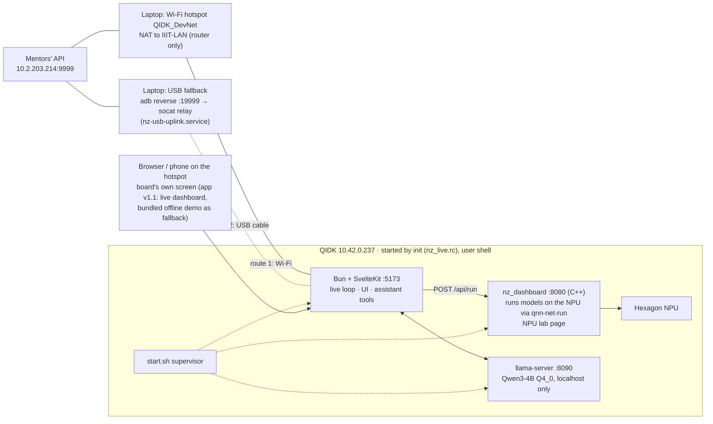

# NZ-Edge: system design (as built)

*Last updated 2026-11-17. Describes what runs on the QIDK today. For what comes next, see [plan_integrated.md](archive/plan_integrated.md). For how the dashboard's map, Net zero page and assistant work in detail, see [qidk_export/dashboard/HOW_IT_WORKS.md](qidk_export/dashboard/HOW_IT_WORKS.md).*

---

## 1. What it is

One Qualcomm QIDK board (Snapdragon 8 Gen 3, SM8650, Android 14) that, unattended:

1. **Fetches** campus readings from the mentors' API every 15 minutes (synthetic 2026 data, replayed in real time).
2. **Forecasts** campus grid draw and the Palash solar plant on the **Hexagon NPU** (LSTMs, AIMET W8A16, ~5 ms).
3. **Flags** readings far from the forecast (per-hour limits fitted on 2025 validation data).
4. **Shows** it all in a dashboard served from the board (Live · Map · Net zero · NPU lab), and **explains** it through an assistant (Qwen3-4B on the board's CPU).

It only measures and explains; it doesn't control any equipment ([plan_integrated.md](archive/plan_integrated.md) §2.1). Live flags on synthetic data are false alarms by construction, so demos use fault injection.

## 2. Topology

| Process | Port | Binds | Role |
|---|---|---|---|
| `nz_dashboard` | 8080 | 0.0.0.0 | Runs any registered model on the NPU: through a **resident runner** (`nz_runner`, ~3–5 ms per window) when warmed, otherwise one-shot `qnn-net-run` (~1.8 s, also FP32 on the CPU); serves the NPU lab page and the Android app's backend |
| Bun + SvelteKit (`build/index.js`) | 5173 | 0.0.0.0 | Live loop, dashboard UI, chat endpoint, relay `/npu-app/*` → :8080 |
| `llama-server` | 8090 | 127.0.0.1 | Assistant model, OpenAI-compatible API with tool calling |

## 3. Start-up and supervision

* `/system/etc/init/nz_live.rc` (source: [nz_live/board/nz_live.rc](nz_live/board/nz_live.rc)) starts `/data/local/tmp/nz_live/start.sh` on `sys.boot_completed=1` as `shell` (`u:r:shell:s0`). Init restarts the supervisor if it dies.
* [start.sh](nz_live/board/start.sh) starts the three processes in the foreground, restarts any that exit (back-off 2–60 s), and logs to `nz_live/logs/`.
* Power cycle → everything back, with the API and NPU OK, within ~5.5 min (test A5).
* Details, network setup and undo commands: [nz_live/STATUS_boot_network.md](nz_live/STATUS_boot_network.md).

## 4. The live loop (`qidk_export/dashboard/src/lib/server/live/`)

Runs inside the Bun server when `LIVE=1`. One cycle per 15-minute bin, 2 minutes after the bin closes:

| Step | What | Code |
|---|---|---|
| Clock | "Now" = the API's `replay_now`, tracked against a monotonic clock (the board's wall clock is unreliable) | `loop.ts` `syncClock` |
| Ingest | Last 50 h of raw readings for the 7 served nodes; same mapping and cleaning as training (signs, units, swapped fields) | `features.ts` |
| Features | 15-min UTC means → ffill(4) + `was_imputed` → min-max per feature from the model's `meta.json` → IST cyclic features. **3 unserved solar nodes are neighbour copies, KH04-00 = 0** | `features.ts` |
| Warm-up | 20 s before each check: `POST :8080/api/warm?models=<active + shadow>&ttl=45`; the runners exit 45 s after their last request | `loop.ts` `warm` |
| Inference | `POST :8080/api/run?model=<active model>&variant=aimet_w8a16`, FP32 on the CPU if the NPU fails | `loop.ts` `runNpu` |
| Shadow mode | Every other Grid model forecasts the same reading (own limits, never alerted); **persistence** and **same time yesterday** are scored for both signals → `shadow.jsonl` | `loop.ts` `shadowModels`, `baselines` |
| Detection | Flag ⇔ \|actual − forecast − median[hour]\| > limit[hour] (per model, from its `meta.json`). Grid and PL00 only | `detect.ts` |
| Outputs | Latest status; **events** (flags and injected faults) → `events.jsonl`; **history** (every checked reading: actual, forecast, normal range, model) → `history.jsonl` | `loop.ts` |
| Backfill | After start-up or a model switch: re-forecast the last 24 h from past windows (history only, never events) | `loop.ts` `backfill` |
| Catch-up | After an outage or restart (last checked bin saved in `last_bin.json`): every missed bin, up to 24 h, is checked as the cycle would have; flags become events marked **late** (no banner, shown as "found after an outage"). It warms the NPU runners first (since 19 Nov), so 24 h of catch-up takes ~1 min | `loop.ts` `catchUp` |
| Fault injection | `POST /api/live/inject {signal, kind, steps}` alters the next 1–4 actual readings (UI only) | `loop.ts` `requestInject` |

Files on the board (`/data/local/tmp/nz_live/live/`): `events.jsonl`, `history.jsonl`, `shadow.jsonl`, `active_models.json`.

**Resident runner** ([nz_live/runner/nz_runner](nz_live/runner/nz_runner)): Qualcomm's SDK SampleApp, with a `serveOnce` method that executes an input list without freeing the finalized graphs, and a stdin loop (`NZ_SERVE=1`): `<input_list> <output_dir>` → `OK <µs>`. Built with the SDK image's NDK; binary at `nz_live/bin/nz_runner` on the board. `nz_dashboard` forks one per model (`/api/warm`), feeds it requests, and a reaper thread stops idle ones. Start-up ~1.8 s per model, ~3–5 ms per window, output identical to `qnn-net-run` (47.5 dB vs FP32).

## 5. Models and the switcher

**Registry.** `/data/local/tmp/nz_live/models/`:

| File | Read by | Format |
|---|---|---|
| `registry.txt` | `nz_dashboard` (at start) | `<id> <n_features> <dir>` per line; `<dir>/libw8a16.so` (HTP), `<dir>/libfp32.so` (CPU) |
| `registry.json` | live loop, UI, assistant | id, label, family, horizon, signals, +15-min R² (val/test), SQNR, NPU ms |
| `<id>/meta.json` | live loop | features (order, min/max), lookback, capacities, per-hour anomaly limits, metrics |

The built-in models (`all_sensors_1h`, `all_sensors_24h`, `single_node`) keep their old paths under `/data/local/tmp/nz_aimet/`.

**Models available for the Grid signal** (scored the same way: R² of the +15-minute forecast, 2025 test split; NPU vs FP32 on one validation window):

| id | Family | Horizon | Solar R² | Grid R² | SQNR | NPU ms |
|---|---|---|---|---|---|---|
| `all_sensors_1h` (default) | LSTM (team, deployed) | 1 h | 0.966 | **0.824** | 46–48 dB* | ~5 |
| `guided_h4` | LSTM, LightGBM-gated | 1 h | 0.964 | 0.778 | 47.5 dB | 4.6 |
| `baseline_h4` | LSTM | 1 h | 0.928 | 0.666 | 47.7 dB | 4.8 |
| `guided_24h` | LSTM, LightGBM-gated | 24 h | 0.905 | 0.743 | 45.4 dB | 4.5 |
| `baseline_24h` | LSTM | 24 h | 0.917 | 0.680 | 44.5 dB | 5.0 |
| `cnn_lstm_24h` | CNN-LSTM | 24 h | 0.896 | −0.876 | 44.1 dB | 3.1 |

\* From earlier on-device checks (46.0 dB on API windows). PL00 has one model (`single_node`). LightGBM (24 h) needs a CPU runtime and isn't switchable yet.

**How the newer models' files were made:** [nz_live/scripts/build_model_meta.py](nz_live/scripts/build_model_meta.py) builds each `meta.json` (features in the model's own training order; same scaler as the deployed models; limits fitted with the same rule as `anomaly.py`). [check_models_on_board.py](nz_live/scripts/check_models_on_board.py) runs the on-device SQNR check. The QNN libraries are the benchmark's builds (`benchmark_qidk`), copied into `nz_live/models/<id>/`.

**Switching.** On the Live page's Grid card, or `POST /api/live/models {signal, model}` (UI only; the assistant can list models but never switch them). The loop loads the meta, saves the choice in `active_models.json` (it survives restarts), re-forecasts the last 24 h with the new model, and uses it from the next cycle.

## 6. Dashboard (`qidk_export/dashboard/`, SvelteKit on Bun)

| Route | What |
|---|---|
| `/` **Live** | NPU forecasting front page: status tiles; Grid and Palash cards (latest reading, forecast, allowed deviation, next hour, 24 h actual-vs-forecast chart with normal range and flags, fault-test buttons, model selector); recent flags with "Ask"; campus solar next hour; models table |
| `/map` | All 365 nodes on the campus map, node details from `campus.sqlite` (2025 history) |
| `/whatif` **Net zero** | Carbon balance and extra-solar what-if (2025 data). A **net-metering** switch decides whether surplus solar is exported and credited or wasted. The page states the solar needed for zero (+1,225 %, only with net metering or storage) and the floor without export (night load: net can't drop below ~1,118 t). "Today's solar" counts only the 3 meters with a clean 2025, so its multiples are overestimates |
| `/results` **Results** | Are the forecasters worth it? Verdict per horizon (best model vs best baseline), all models × persistence/yesterday on 2025 data with skill, the live shadow scoreboard (24 h / 3 d / 7 d), LightGBM gain importance by meter and input kind, per-hour allowed deviation |
| `/npu` **NPU lab** | The :8080 dashboard (replays, day-ahead, single NPU runs, FP32 vs NPU), through the `/npu-app/` relay; opens on "Run on NPU" |

| API | Use |
|---|---|
| `GET /api/live/status`, `/api/live/history?hours=`, `/api/live/events?since=` | Live state, chart data, flags |
| `GET/POST /api/live/models` | List models / switch (UI) |
| `GET /api/live/results?hours=` | Live shadow scores + offline 2025 results + per-hour limits (Results tab) |
| `POST /api/live/inject` | Fault injection (UI) |
| `POST /api/chat` | Assistant (streams; tool calls) |
| `/npu-app/*` | Relay to `nz_dashboard` |

## 7. Assistant

Qwen3-4B (Q4_0, llama.cpp, 6 threads on the board's CPU; ~6 tok/s; 13–39 s per answer). It answers only by calling tools:
* **6 database tools:** overview, search, node details, statistics, compare, show on map
* **`what_if`:** net-zero calculator
* **5 live tools:** `live_status` (now says which model forecasts), `recent_anomalies`, `explain_anomaly`, `list_models`, `model_results` (accuracy vs the baselines, live and 2025; input importance)

The prompt routes by keywords and requires a tool call. It never calls a flag a confirmed fault, and it can't switch models or inject faults.

## 8. Testing

| Test | What | Latest |
|---|---|---|
| A1 | TS windows = Python windows on the same raw files | 1.2e-7 |
| A2 | Fast replay of 16 cached API days through the real `loop.ts` (`scripts/live_replay.ts` + `verify_api_lstm/replay_server.py`) | Grid 41/41, PL00 12/12, injected 20/20 (re-run 17 Nov after each change) |
| A3 | Live run | 24 h: Grid 1.0 % natural flags, PL00 0 % |
| A5 | Power cycle, no USB | Back in ~5.5 min |
| A7 | Assistant question set | Right tool 10/10 |
| M2 | NPU vs FP32 per switchable model | 44.1–47.7 dB |
| Switcher | Switch / reject / persist across restart / 24 h model | Passed on the stand-in server, 17 Nov |
| Persistence | Every model vs persistence and same-time-yesterday (`nz_live/scripts/offline_results.py`) | 2025 +15 min: persistence wins (Grid 0.937 vs best model 0.936); models win for 1 h solar (+0.45) and 24 h grid; yesterday wins 24 h solar |
| Runner | Resident vs one-shot | 3–5 ms vs ~1.8 s per window; same output |

## 9. Operations

| Task | How |
|---|---|
| Deploy a dashboard build | `bun --bun vite build`; push `build/` to `nz_live/dashboard/build.new`, swap, `kill $(cat nz_live/run/dashboard.child.pid)` (the supervisor restarts it; history is backfilled) |
| Add a switchable model | Its QNN `libw8a16.so`/`libfp32.so` + `meta.json` in `nz_live/models/<id>/`; a line in `registry.txt`; an entry in `registry.json`; restart `nz_dashboard` (kill its child pid) |
| Restart everything | `adb root; adb shell stop nz_live; adb shell start nz_live; adb unroot` |
| Logs | `/data/local/tmp/nz_live/logs/{supervisor,nz_dashboard,llama-server,dashboard}.log` |
| Undo the boot service | `adb root && adb remount && adb shell rm /system/etc/init/nz_live.rc && adb reboot` |

## 9a. API routes and the USB fallback (19 Nov)

The live loop has an ordered list of routes to the API (`LIVE_API`, comma-separated; `start.sh` sets
`http://10.2.203.214:9999,http://127.0.0.1:19999`, and `loop.ts` always appends the USB route unless `LIVE_USB=0`).
At the start of every cycle the clock sync probes them in order (6 s each) and the whole cycle uses the first that
answers, so the loop moves to USB within one cycle and back to Wi-Fi as soon as that works again. Every switch is
logged (`API route: …`), and the Live page's data-feed tile and `/api/live/status` (`api.route`) show the route in use.

The USB route: on the board `127.0.0.1:19999` → `adb reverse` over the cable → laptop `127.0.0.1:19999` → `socat` →
API. [nz_live/laptop/usb_uplink.sh](nz_live/laptop/usb_uplink.sh) runs the relay and re-adds the reverse after a replug
(every 10 s); it runs as the systemd **user** service `nz-usb-uplink.service`
([unit](nz_live/laptop/nz-usb-uplink.service), installed in `~/.config/systemd/user/`, enabled). The laptop opens the API
connection itself, so Docker's `FORWARD` drop doesn't affect this route. Needs the cable, adb authorized, and the
laptop awake and on a campus network (wired or `wifi@iiith`).

Tested 19 Nov: A2 replay unchanged (Grid 41/41, PL00 12/12, injected 20/20); direct route refused → USB in < 1 s, silent
→ USB after ~7 s, working → direct; then for real on the board when the laptop moved to `wifi@iiith` and the hotspot
went down: the loop picked USB, caught up the 2 missed checks and kept running.

| Task | How |
|---|---|
| Status | `systemctl --user status nz-usb-uplink`; `adb reverse --list` shows `tcp:19999` |
| Logs | `journalctl --user -u nz-usb-uplink` |
| Stop / disable | `systemctl --user disable --now nz-usb-uplink` |

## 10. Known limits

* The laptop is still the only way to the API: over the hotspot (whose forwarding rule is lost on a laptop reboot until the `daemon.json` fix is applied) or, since 19 Nov, over the USB fallback. Both stop if the laptop sleeps.
* 4 of 11 campus-model inputs aren't served (neighbour copies / zero); campus solar and KH04 room load ("Demand") can't be checked live.
* Grid −40 % faults at morning load fall inside the limit.
* The one-shot `qnn-net-run` (used when no runner is warm) often crashes with SIGSEGV while exiting, after writing its output: harmless to results, but it leaves a crash report each time. The live loop avoids it by warming runners before each cycle and before catch-up (WORKLOG_2026-11-19 §3).
* Per check, starting the 7 runners takes ~10.8 s of CPU work (more while the assistant is busy); per window the NPU is 3–5 ms vs 0.3–0.5 ms for ONNX Runtime on the CPU (WORKLOG_2026-11-19 §5).
* The switchable models' limits are fitted on 2025 validation data (FP32) but not yet checked on API data the way the default was (M4); their live flag rates are unverified.
* Synthetic data: no real events or drift; every live flag on normal data is a false alarm.
* NPU is slower than the CPU at batch 1 for these models ([benchmark_qidk/RESULTS.md](benchmark_qidk/RESULTS.md)); the batch-sweep and CPU-contention measurements are planned (W6).
