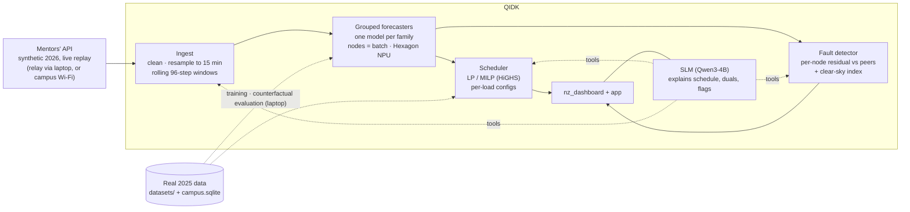

# Plan: tying the threads together (feasibility report)

*Written 2026-11-16. Status: assessment and proposed plan. Nothing here is built yet. Facts marked "checked" were verified on this date: the API by querying it, the board over adb, the data by reading the files.*

**The four threads:**

| # | Thread | Source |
|---|---|---|
| 1 | **Flexible-load scheduler** (pumping first), MPC every 15 min, counterfactual on 2025 | [NZ-Edge Project Direction (post-mideval).md](NZ-Edge%20Project%20Direction%20(post-mideval).md) |
| 2 | **Campus assistant (SLM)** on the board, wired to the forecasters | [qidk_export/INTEGRATION_PLAN.md](qidk_export/INTEGRATION_PLAN.md) |
| 3 | **Grouped models**: one model per family of nodes that move together (solar, water, …), so a forecast becomes one large matrix multiplication on the NPU | team proposal |
| 4 | **The mentors' API** `http://10.2.203.214:9999/api` as the data source | mentors / TAs |

---

## TL;DR

* **They fit together, and better than they look on their own.** The API is the live input. The grouped models produce per-node forecasts on the NPU. The scheduler turns forecasts into actions, and the fault detector flags what's broken. The SLM is the interface that explains both. That is the direction doc's "one board, one control loop", with each thread as one stage.
* **Thread 3 is worth doing, but not as an "artificial" NPU boost.** Done the right way (one shared model per family, **nodes as the batch dimension**), it's the honest version of the same idea: the real workload is *forecasting every node*, not 3 campus totals, and at that size the NPU should beat the CPU. That's a hypothesis to measure, and a cheap one. It also fixes a known weakness: campus-total models catch **0 %** of single-panel damage (doc 18). Per-node forecasts are what peer-based fault detection needs. Done the other way (all nodes as input features of one model), it doesn't help the NPU at all.
* **Thread 4 works but needs adapting.** The API is reachable from the laptop. It's a **live replay of synthetic 2026 data**, the same data as the `synthetic_2026` source already in `campus.sqlite` (spot-checked: 636.8 vs 639.1 kW for the same hour). It **cannot feed the current 58-feature models**: 4 of their 11 input nodes aren't served, and solar units and signs are inconsistent. **The board can't reach it today** (no network on the QIDK).
* **Everything is synthetic in the API.** Use it for the *live demo* and for *online* checks ("forecast now, score it in 15 minutes"). Keep the *evaluation* (accuracy, counterfactual savings) on **real 2025 data**, as the direction doc says. Mixing the two would undermine every number.
* **The real constraint is time, not feasibility.** The direction doc has 8 work items, and the SLM plan has 6 phases. §6 is a cut list ordered by what the final demo needs. The SLM moves to the end and becomes the interface to the scheduler instead of a separate feature.

---

## 1. What was checked

### 1.1 The API (`http://10.2.203.214:9999`), checked 2026-11-16

| | |
|---|---|
| What it says it is | *"Smart City Living Lab – Summary Dashboard API (synthetic 2026 data)"*. *"Synthetic data replayed against the clock: readings never go past `replay_now`."* |
| Server | gunicorn (Django-style). No OpenAPI or docs page; `/api/` itself lists the endpoints |
| Endpoints | `/verticals/all/latest`, `/verticals/all/nodes`, `/verticals/all/temporal?from&to&type&node_id` (raw readings), `/verticals/avg/`, `/graph/?type&nodes&start&end&interval=minute\|hour\|day`, `/synthetic/status` |
| Auth | `temporal` mentions an optional `X-INTERNAL-API-KEY` header. **Not required today**: every call worked without it |
| Nodes | **180** across 13 verticals: SR-AC 87, WN 30, AQ 13, SR-AQ 12, CM 9, WL 9, WD 4, WF 4, EM 3, SL 3, SR-OC 3, SR-EM 2, WE 1 |
| History | From 2026-01-01 up to "now" (the replay clock). Readings come every few minutes; SL-PL00-00 gives 6 per hour |
| Same as our data? | Yes for the plain synthetic set. SB00 grid power for 3 Mar 2026 06:00–07:00 UTC: API 636.8 kW vs `campus.sqlite` source `synthetic_2026` 639.1 kW. The `synthetic_2026_scenario` source (injected events) gave 385.0 kW, so **the API does not serve the scenario version**. The source files appear to be `datasets/esw-netzero/` (same node files) |
| Reachable from the board? | **No.** The QIDK has no IP on `wlan0` (`Network is unreachable`). It has `curl` |

**API vs the current forecasters' inputs (58 features, 11 nodes):**

| Needed node | In API? | Note |
|---|---|---|
| EM-CR-SB00-00 | ✅ | All fields (`gdpower`, `t1power`, `t2power`, `gdvll`, `lt1vln`, `lt2vln`…). Names differ (`gdpower` vs `gd_power_W`) |
| EM-CR-KH95-00 | ✅ | |
| SR-EM-KH04-01, -02 | ✅ | |
| SL-PL00-00, SL-NI01-00, SL-VN95-00 | ✅, with data-quality problems | Daytime `active_power_3`: NI01 ≈ **−130,000** (W, negative sign); PL00 ≈ **−55** (looks like kW, negative); VN95 = **3** while its phases read ≈ 37 each. The 2025 cleaning rules (sign, W/kW, phase sums) have to be re-applied |
| SR-EM-KH04-00 | ❌ | |
| SL-NI03-00, SL-NI03-01, SL-VN02-01 | ❌ | 3 of the 6 solar nodes |

**Conclusion:** the deployed models can't run on API data without inventing 4 nodes' inputs. Any model meant to run live on the API has to be **trained on the nodes the API serves**. That makes thread 3's retraining a requirement rather than an option.

### 1.2 Real 2025 data for the scheduler (thread 1)

* **Energy and solar:** as used so far (`datasets/esw/`, `campus.sqlite` measured sources).
* **Water:** `datasets/Water/` (not loaded into `campus.sqlite`, which has only a few hundred measured water rows):

  | File | Best-covered nodes |
  |---|---|
  | `WM-WF.csv` (flows, 157 MB) | PH03-03 478 k rows Feb–Dec · PH03-02 320 k Feb–Dec · PH03-01 183 k Mar–Dec · PH03-00 169 k Feb–Sep · PH01-00 126 k Mar–Dec · PH04-70 53 k Feb–Nov |
  | `WM-WL.csv` (tank levels, 28 MB) | BK00-00 Jan–Sep · PH03-01 Jan–Sep · KH98-00 Jan–Aug · AN00-00 Feb–Sep · PL00-00 Feb–Jul · PH03-00 Jan–Jun · KH00-00 only 12 days |

  The pumping case has real flows for most of 2025 and real tank levels for about half of it. That's enough for a counterfactual with placeholder pump ratings (as the direction doc plans). It's not enough for a learned water forecaster on the NPU (§2.3).

### 1.3 Board and existing models

* QIDK SM8650: 9.4 GB RAM free, 168 GB storage free, **no Python**, **no network** right now.
* Measured (`benchmark_qidk/RESULTS.md`): one window, batch 1, guided 1 h LSTM: **NPU 4.8 ms (3.3 ms compute)** vs **ONNX Runtime CPU 0.55 ms**. The NPU loses at batch 1.
* Guided LSTM: 2 layers × 96 hidden (1 h) or 128 (24 h). About 13 M multiply-adds per forecast, which is tiny for the NPU. Its 3.3 ms is spent on **192 small sequential steps**, not on arithmetic.
* No scheduler code and no API client exist yet.

---

## 2. Thread by thread

### 2.1 Thread 4: the mentors' API. Feasible, with adaptation.

| Use it for | Don't use it for |
|---|---|
| The live input of the demo: the board polls it every 15 min, forecasts and schedules, like a deployed system | Accuracy or savings numbers. It's a generator built from 2025 patterns, so a model scoring well on it mostly shows it learned the generator |
| **Online forecast checks:** forecast at *t*, fetch the real (synthetic) value at *t* + 15 min. No other data we have gives a forecast we didn't see the answer to | Training the energy and solar models: real 2025 data exists for those |
| Verticals with no real history (SR-AC: 87 AC nodes, AQ). Clearly labelled as synthetic | Faults: it serves the non-scenario version, so there are no events in it. Fault injection stays ours |

**What has to be built:**
1. **Board connectivity.** Either put the QIDK on the campus Wi-Fi (`10.2.x` is campus-internal, so this only works on campus), or relay through the laptop: `socat TCP-LISTEN:9999,fork TCP:10.2.203.214:9999` on the laptop plus `adb reverse tcp:9999 tcp:9999`. With the relay the board sees the API at `127.0.0.1:9999`. Test both before the eval.
2. **Ingest on the board:** poll `/verticals/all/temporal` for the last 24 h of the modelled nodes, apply the cleaning rules (sign, units, phase sums, sentinel values), resample to 15 min, keep a rolling 96-step window per node. This is C++ in `nz_dashboard` (the board has no Python), or the TS server if the SLM's Bun question gets solved (see the SLM plan, Phase 3).
3. **Offline fallback:** if the network fails during the eval, replay the same data from `campus.sqlite` (`synthetic_2026` source) against the clock. It's the same data, so the demo looks identical. Spot-check more than one hour and one node before relying on that.

### 2.2 Thread 3: grouped models. Feasible and recommended, in one specific form.

There are two ways to "put a family of nodes in one model". Only one of them helps the NPU:

| | **A. Shared model, nodes as the batch** (recommended) | B. One multivariate model per family |
|---|---|---|
| Shape | One set of weights per family (solar, building load, AC, …). Input per node: its own history + time features + optionally the family mean. Batch = number of nodes | All nodes of the family are input features; outputs all of them |
| What the NPU sees | Per time step, an `[N nodes × 154] · [154 × 384]` **matrix–matrix** product instead of a matrix–vector one. This is the "one massive matrix multiplication", for real | Still batch 1: a wider vector times a matrix. Little change in NPU efficiency |
| Node added or removed | Works unchanged (one more batch row). Ties directly to doc 18's leave-one-node-out goal | Retrain |
| Accuracy | Pooling many similar series usually helps ("global" forecasting models). It also gives per-node residuals | Can learn cross-node effects, but overfits easily with few nodes |
| Fault detection | **Per-node forecast → per-node residual → compare with peers.** This is exactly the direction doc's "one node collapses = fault" | Same in principle, but tied to the fixed node set |

**Why A is not "artificial":** the honest workload of a campus edge box is *forecast every metered node every 15 minutes*. The API alone has 180 nodes. Batch 1 on 3 campus totals is the toy case, and that's where the NPU lost. The claim to test:

> At batch 1 the NPU's time is 192 tiny sequential steps, far below its compute limit. So the NPU's time per call should stay nearly flat as nodes are added, while the CPU's grows roughly linearly. If so, the NPU wins above a crossover somewhere in the tens of nodes.

That's a hypothesis, and the measurement is cheap: export the existing guided LSTM with batch N ∈ {1, 8, 32, 64, 180}, build with the existing `benchmark_qidk/scripts/04_qnn_build.sh` flow, and time NPU vs ONNX Runtime CPU. **About one day, and it should come before any retraining.** If the crossover doesn't appear, the report says so, and that's still a result.

**A second, stronger argument for the NPU:** in the integrated system the **CPU is busy** with the SLM (llama.cpp uses 4–6 big cores while it generates), the scheduler and the server. Forecasting on the NPU keeps the forecasts on time while the assistant is talking. Measure it: forecast latency on the CPU vs the NPU *while the SLM generates*.

**Watch out:**
* Report latency **and** throughput **and** CPU at the same batch. Comparing a batched NPU with a batch-1 CPU is the "artificial" version, and an examiner will spot it.
* The direction doc says "at one inference per 15 minutes, idle draw dominates". That's still true. Energy per forecast falls with batching, but the board's daily energy barely changes. Say so.
* Families with weak data: **water** (§2.3) and **AC** (synthetic only) shouldn't get learned NPU models for the evaluation. Use them in the live demo, labelled.
* Distillation (direction doc item 6) fits naturally: **the grouped model is the student**, and LightGBM is the teacher.

### 2.3 Thread 1: scheduler (direction doc). Feasible. It's the core and should stay that way.

* **Size:** 96 steps × a few loads → hundreds of variables. HiGHS solves an LP of that size in milliseconds; a MILP with on/off pumps is still well under a second. No feasibility issue.
* **Where it runs:** the board has no Python. Options: **HiGHS compiled with the NDK** into `nz_dashboard` (C++, same toolchain as now), or **`highs-js` (HiGHS in WebAssembly)** inside the TS server, if the dashboard ends up on the board. Develop and evaluate in Python (`highspy`) on the laptop, then port the solved formulation. Keep one formulation file shared by both.
* **Forecasts it needs:** grid and solar (energy family), tank levels and inflow (water). **Water should start without a learned model**: a seasonal profile per hour and weekday from the 2025 flows, with ranges. Add a learned model only if it measurably changes the schedule ("does forecast error change the recommendation?", doc 18 §7).
* **Data:** real 2025 water and energy (§1.2) for the counterfactual. Live API for the demo loop, where it shows the schedule moving as new readings arrive.
* **Open estates questions** (pump ratings, tariff, whether solar is behind the meter) don't block anything. They're the direction doc's placeholder ranges with sensitivity analysis.

### 2.4 Thread 2: the SLM. Feasible, but re-aim it and put it last.

The SLM plan (`qidk_export/INTEGRATION_PLAN.md`) still holds technically. Its role changes with the other threads:

| Was (SLM plan) | Becomes |
|---|---|
| Tools over `campus.sqlite` + historical test-window forecasts | Tools over the **live loop**: `latest` (API), `forecast` (grouped NPU models, current window), `schedule` (current plan + **LP duals**: "why is pump 2 at 14:00?", "what's an extra kL of tank worth?"), `faults` (current flags with peer comparison) |
| "Nothing is live" caveat | Live (synthetic replay) for the demo; historical (2025 real) for evaluation questions. The tools label which is which |
| Its own feature | **The interface to the scheduler.** The direction doc's "interpretable output from the LP duals" is exactly what a tool-calling SLM is good at saying in plain words |

The memory budget still fits: SLM ≈ 4 GB + `nz_dashboard` + the scheduler, out of 9.4 GB.
**Priority: last.** The scheduler and the forecasts carry the project; the SLM makes them easier to present. If time runs out, its Phase 1 (llama-server on the board, current tools) is a ½–1 day demo on its own.

---

## 3. How it fits: one board, one loop

**Two modes, never mixed:**

| | Evaluation mode (the numbers in the report) | Live mode (the demo) |
|---|---|---|
| Data | Real 2025 (energy, solar, water flows and levels) | API, synthetic 2026, replayed live |
| Where | Laptop (Python), with device numbers from the board | The board, end to end |
| Output | Accuracy, peak reduction (kW), kWh, ₹, sensitivity ranges, fault precision and recall | A schedule that updates every 15 min, flags, an assistant answering about them |

---

## 4. Feasibility verdict

| Thread | Feasible? | Biggest risk | Mitigation |
|---|---|---|---|
| 1 Scheduler | **Yes** | Placeholder pump/tank parameters dominate the result | Ranges + sensitivity analysis (already in the direction doc) |
| 3 Grouped models, form A | **Yes**; NPU benefit **likely but unproven** | No crossover appears (e.g. the per-step overhead grows with batch) | Batch sweep first (1 day) and decide afterwards. The per-node fault-detection benefit holds either way |
| 3 Grouped models, form B | Feasible, **not worth it** | Doesn't change NPU efficiency | Don't do it |
| 4 API | **Yes** | Board not on the network; synthetic data mistaken for evidence; 4 input nodes missing | Laptop relay + `campus.sqlite` replay fallback; two-mode rule (§3); retrain on API nodes |
| 2 SLM | **Yes**, at reduced scope | Bun on Android; time | Keep the dashboard on the laptop if needed; SLM last |
| All four in one loop | **Yes, if cut to fit the time** | Too many fronts at once | §6 |

---

## 5. Decisions needed (from the team, or the mentors)

1. **Final evaluation date.** It sets the cut line in §6. (Also an open question in the direction doc.)
2. **Is the API mandatory for *evaluation*, or for the *system*?** If the mentors expect results computed on the API's data, every number becomes "on synthetic data" and the report has to say so prominently. The recommendation is: system on the API, evaluation on real 2025. Confirm it with them.
3. **Which families get learned models.** Recommendation: **solar** (6 real nodes) and **building / grid load** (SB00, KH95, KH04). Water and AC use profiles in the evaluation and appear in the live demo, labelled synthetic.
4. **Does the board go on the campus Wi-Fi**, or does the demo use the laptop relay?

---

## 6. Proposed work order and cut lines

Effort is in working days for one person. The direction doc's items are marked **[D#]**, the SLM plan's phases **[S#]**.

| # | Task | Days | Why at this point |
|---|---|---|---|
| 1 | Direction doc's quick fixes (rename "Demand" → "KH04 room load", grid gap, missing solar nodes, …) **[D1]** | 1–2 | Things an examiner would catch |
| 2 | **Batch sweep on the NPU** (existing LSTM, N = 1…180) + CPU contention test | 1 | Decides thread 3 cheaply, before any retraining |
| 3 | API client + cleaning + 15-min resampling (laptop first, Python), and a comparison against `campus.sqlite` `synthetic_2026` over a week, several nodes | 1–2 | Every later stage reads this |
| 4 | **Pump scheduler** LP/MILP on real 2025 water + grid, placeholder ranges, counterfactual **[D3]** | 3–4 | The core result |
| 5 | **Grouped forecasters, form A** (solar + load), trained on real 2025 restricted to API-served nodes; LightGBM teacher → student distillation **[D5, D6]**; W8A16 on the NPU | 3–5 | Gives the scheduler its forecasts, and fault detection per-node residuals |
| 6 | Fault injection + peer / clear-sky detector on per-node residuals **[D4]** | 2–3 | Uses step 5's per-node outputs |
| — | ***Minimum credible final: steps 1–6*** | ***≈ 11–17*** | |
| 7 | Live loop on the board: ingest (C++) → NPU forecasters → HiGHS → `nz_dashboard`; laptop relay to the API | 3–4 | Turns results into the live demo |
| 8 | CPU vs NPU energy with an inline meter **[D2]** | 1–2 | Needs the meter. Do it whenever the meter arrives |
| 9 | SLM: llama-server on the board **[S1]**, tools retargeted to schedule / duals / faults / latest **[S2]**, short evaluation **[S5]** | 3–4 | Interface on top of a working loop |
| — | ***Full integrated demo: steps 1–9*** | ***≈ 18–27*** | |
| 10 | Second and third loads (AC pre-cooling on synthetic AC, GPU jobs) **[D7]** | 3+ | Shows generality; drop first if short of time |
| 11 | Dashboard server on the board **[S3]**, SLM speed work **[S4]**, app tab **[S6]** | 2–5 | Polish |
| 12 | Campus energy picture, water balance write-up **[D8]** | 2 | Written last, per the direction doc |

**If time is short, cut from the bottom.** Steps 1–6 make a complete, defensible project without the API live loop or the SLM, but decision 2 in §5 may mean the API is required in the system. In that case step 7 moves above step 6.

---

## 7. What changes in existing documents

* **`qidk_export/INTEGRATION_PLAN.md`:** its Phase 2 tools (`forecast` over historical test windows, `check_anomalies` over the recorded pack) are superseded by the live-loop tools in §2.4 once steps 5–7 exist. Phases 1, 3, 4 and 5 stand. Until then it's still a valid stand-alone demo.
* **Direction doc:** no conflict. This plan adds the API (live mode), specifies the grouped-model form for its "distilled model on the NPU", and places the SLM as the interface to its "interpretable output from the LP duals".
* **`PROJECT_HISTORY.md`:** add a timeline row and a short "post-mideval" section once decisions in §5 are made.
