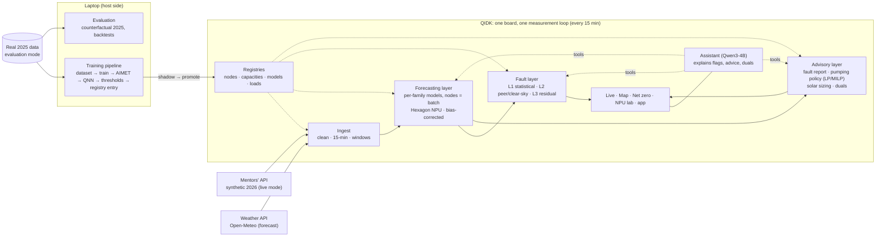

# NZ-Edge: integrated plan and roadmap

*Written 2026-11-17. Merges every plan and roadmap in this folder into one. The source documents stay as detailed references (§10). Where they disagree, this file says which way it goes and why (§3).*
*Revised again 2026-11-17 (evening) after an outside review and the persistence test. **§12 is the current headline framing and supersedes the phase table where they differ.** In short:
* QAT is cut.
* CPU contention leads the NPU argument.
* Every result is reported against persistence and same-time-yesterday.
* Shadow mode, the resident NPU runner and the Results tab are built.
* Weather and irradiance: §12.4.*
*Revised 2026-11-17 for **read-only access**: we can measure the campus but not control anything. The decision layer is now advisory (§2.1, W5), faults are the main deliverable (W4), the extra flexible loads are cut (W8), and phases are re-estimated (§6).*

**Sources:**

| Tag | Document | What it contributes |
|---|---|---|
| **[DIR]** | [NZ-Edge Project Direction (post-mideval).md](NZ-Edge%20Project%20Direction%20%28post-mideval%29.md) (12 Nov) | Thesis: flexible-load scheduler (MPC, LP/MILP), fault detection, distillation, CPU vs NPU energy, water, examiner fixes |
| **[PLAN]** | [plan.md](plan.md) (16 Nov) | How the four threads fit: scheduler, SLM, grouped models (nodes = batch), mentors' API. Two-modes rule, batch sweep, cut lines |
| **[ST]** | [plan_reduced_shortterm.md](plan_reduced_shortterm.md) + [nz_live/runs/RESULTS_2026-11-16.md](../nz_live/runs/RESULTS_2026-11-16.md) + [nz_live/STATUS_boot_network.md](worklogs/STATUS_boot_network_2026-11-16_19.md) | **Built:** self-contained QIDK on the live API, existing LSTMs on the NPU, anomaly flags, on-board SLM, boot start. Tests A1–A8 |
| **[SLM]** | [qidk_export/INTEGRATION_PLAN.md](qidk_export/INTEGRATION_PLAN.md) | SLM phases 1–6: board build, tools, dashboard on the board, speed, evaluation, app |
| **[D18]** | [aimet_quantization/18_future_revisions_and_ideas.md](aimet_quantization/18_future_revisions_and_ideas.md) | Models that evolve (drift, bias correction, head refit, champion/challenger), weather, almanac, QAT, scalable per-node detection, "decisions, not metrics" |
| **[BQ]** | [benchmark_qidk/RESULTS.md](../benchmark_qidk/RESULTS.md) | Measured: 9 models on the board, NPU vs CPU speed, accuracy, power (preliminary) |
| **[SW]** | [plan_model_switcher.md](plan_model_switcher.md) (17 Nov) | Model registry and switcher; adaptation to new nodes and capacity (node registry, per-node statistical detector, capacity adapter, retraining pipeline) |
| **[POST]** | Team note, 17 Nov | Online bias correction / periodic last-layer refit; weather and campus events; QAT for W8A8 |

---

## TL;DR

* **Thesis: measure, diagnose, recommend. It doesn't actuate.** We have read-only access to the campus data; no pump, AC or job can be controlled from the system. NZ-Edge is one edge board that forecasts campus load, solar and water every 15 minutes, catches what's broken, and recommends what the people who run the campus could change. "Decisions, not metrics" ([DIR], [D18] §7) still holds, but the decisions are made by people:
  * maintenance acting on a fault report
  * estates changing a pumping timetable
  * the campus deciding on solar capacity or a tariff

  Success is measured as **fault precision and recall**, and as the **opportunity** (kW, kWh, ₹) of each recommendation, always given as a range. These are never presented as achieved savings.
* **Where we are:** the *platform* is built and running unattended on the QIDK:
  * live ingest from the mentors' API
  * NPU forecasts (W8A16, ~5 ms)
  * anomaly flags (1.0 % natural Grid flags over 24 h; injected faults 20/20 in replay, 7/8 live)
  * 24 h history
  * an on-board assistant (Qwen3-4B, 10/10 right tool)
  * a model switcher over 7 models (built 17 Nov)
  * a Live / Map / Net zero / NPU lab interface
  * starts at boot, back within 5.5 min of a power cycle

  The *advisory layer* (fault reports, pumping-policy and solar-sizing recommendations) and the *second generation of models* don't exist yet.
* **The plan is 9 workstreams in 5 phases** (§5, §6):
  * **Phase 1:** foundations (registries, batch sweep, measurement)
  * **Phase 2:** better models (shared per-family models on API-served nodes, weather + almanac, distillation)
  * **Phase 3:** recommendations people can act on (static pumping timetable vs rolling MPC on 2025, solar sizing, tariff review)
  * **Phase 4:** adaptation and the quantization study (bias correction, head refit, champion/challenger, QAT)
  * **Phase 5:** polish (assistant over faults and recommendations, write-up)
* **Main resolutions (§3):**
  * **NPU vs CPU:** at batch 1 the CPU is 5–12× faster ([BQ]). The NPU case rests on **batching many nodes** and **keeping the CPU free for the SLM and the scheduler**, both to be measured. QAT's value is likewise framed as headroom for that scale, not as saving power at one inference per 15 min.
  * **Two modes, never mixed:** live system on the synthetic API; every reported number on real 2025 data.
  * **Bias correction is also the drift detector:** publish the bias, don't just absorb it.
  * **One fault-detection stack with three layers** (statistical per node → peer/clear-sky → forecast residual), merging three separate proposals. Its weekly **suspected-faults report** is the main deliverable.
  * **No actuation:** the scheduler is advisory and counterfactual. A best *static* timetable is compared with rolling MPC; extra flexible loads are cut to a paragraph (§3 #13).
* **Rough total:** ≈ 33–47 working days, one person, AI-assisted, for everything (45–64 without overlap). **Minimum credible next milestone (Phases 1–3): ≈ 21–30 days** (29–41 without overlap). Cut lines in §6.

---

## 1. Where we are (17 Nov 2026)

*Updates since, in [WORKLOG_2026-11-19.md](worklogs/WORKLOG_2026-11-19.md): app v1.1 opens the live dashboard; USB fallback route to the API; catch-up warms the NPU runners; the hotspot outage (A6) happened for real 18–19 Nov and catch-up handled it; partial NPU vs CPU check on the live system (§5 there).*

### 1.1 Built and verified

| Piece | State | Evidence |
|---|---|---|
| Boot start | `nz_live.rc` (init, user `shell`) → `start.sh` supervisor → 3 services; restarts anything that dies | A5: back within 332 s of a power cycle, no USB |
| Network | Laptop Wi-Fi hotspot `QIDK_DevNet` with NAT to `IIIT-LAN`; board at 10.42.0.237. **Since 19 Nov:** USB fallback (`adb reverse` + laptop relay), chosen automatically each cycle | Board → API HTTP 200; USB switchover tested and used for real 19 Nov |
| NPU server `nz_dashboard` :8080 | Unchanged; 3 models (`all_sensors_1h`, `all_sensors_24h`, `single_node`), W8A16 + FP32 | NPU 46.0 / 53.7 dB vs FP32 on API windows |
| Live loop (TS on Bun, :5173) | Every 15 min: API → windows → NPU → per-hour limit check → events + history; 24 h backfill after restart | A1 1.2e-7; A2 Grid 41/41, PL00 12/12, injected 20/20; A3 24 h: Grid 1.0 % natural flags, PL00 0 %, 0/16 in 15:00–19:00 |
| Interface | **Live** (NPU forecasting, front page) · Map · Net zero (what-if) · **NPU lab** (old :8080 dashboard via proxy) | Deployed 17 Nov 07:30 |
| Assistant | Qwen3-4B Q4_0 on the board CPU, 10 tools (6 database, `what_if`, 3 live) | A7: right tool 10/10, 13–39 s per answer |
| Models available | 9 forecasters: 7 LSTM (incl. 2 guided), 1 CNN-LSTM, 1 LightGBM. 8 share the 58-input campus window | [BQ], [SW] §1 |
| **Model switcher** (17 Nov) | 7 models switchable for Grid on the board (registry, per-model limits, 24 h re-forecast on switch, selector + models table, `list_models` tool). Scored the same way at +15 min, the deployed `all_sensors_1h` keeps the best Grid R² (0.824) | [SYSTEM_DESIGN.md](../SYSTEM_DESIGN.md) §5 |

### 1.2 Known limits (carried into the plan)

| Limit | Source | Where it's handled |
|---|---|---|
| 4 of 11 inputs not served by the API → neighbour copies (3 solar) and zero (KH04-00) | [ST] §2.2 | W2: retrain on API-served nodes |
| Campus Solar and "Demand" can't be checked live; "Demand" is really KH04 room load (~1.5 % of campus) | [ST], [DIR] fixes | W0 rename; W2 targets |
| Grid −40 % not caught at morning load (165 kW drop vs 190 kW limit) | [ST] A4 | W4: document; W3 bias correction narrows limits |
| Campus-total models catch 0 % of single-panel damage | [D18] §5 via [PLAN] | W2 per-node models + W4 peer detection |
| NPU slower than CPU at batch 1; power not measurable without a meter | [BQ] | W6 |
| Synthetic API: no events, no drift, so live flags are false alarms | [ST], [PLAN] | Two-modes rule (§2.2); injected faults and drift in replay |
| Laptop is the single route to the API (hotspot or, since 19 Nov, USB); forwarding rule lost on laptop reboot; both stop if the laptop sleeps | [ST] §2.7 | W0; campus Wi-Fi on the board (§8 #4) |
| ~~A6 (hotspot outage) not run~~ (happened for real 18–19 Nov, handled); A7 Q6 wording; ~~app tabs not rechecked~~ (A8 done 19 Nov) | [ST] | W0 |
| **No control over any load:** data access is read-only | Team, 17 Nov | §2.1, §3 #13, W5 (advisory only) |

---

## 2. Thesis and ground rules

### 2.1 What the system is
One board, one **measurement** loop ([DIR], [PLAN] §3):

> sensor streams → **ingest** (clean, 15-min) → **forecasting layer** (per-family models on the NPU, online-corrected) → **fault layer** (statistical, peer, residual) and **advisory layer** (fault reports, pumping-policy and sizing recommendations) → **people**, through the dashboard, the app, a weekly report, and the assistant that explains them

**Nothing in the system acts on the campus.** Every decision is made by a person, so the system's job is to give them evidence they can act on:

| Decision | Who could take it | What we provide |
|---|---|---|
| Check or repair a meter, panel or pump | Maintenance | Weekly suspected-faults report: node, layer, evidence, confidence (W4) |
| Change the pumping timetable | Estates | Best static timetable vs actual 2025 operation, with the opportunity as a range (W5) |
| Whether real-time scheduling is worth having | Estates / the project | Rolling MPC vs the best static timetable: does forecasting add value over a fixed rule? (W5) |
| How much solar to add | Campus | Coverage, waste/export and payback ranges (W5) |
| Tariff or contract demand | Campus / finance | The 2025 grid profile under the billing options (W5; needs decision 3) |

**Honest pitch** ([DIR], [D18] §7.5, revised): *"It does not get the campus to net zero, and it doesn't control anything. It shows where the gap is, catches what is broken, and tells the people who run the campus what to change and what that is worth, on a few watts."*

### 2.2 Ground rules (apply to every workstream)
1. **Two modes, never mixed** ([PLAN] §3). *Evaluation mode:* real 2025 data, on the laptop, produces every number in the report. *Live mode:* the synthetic API, on the board, is the demo. A number from live mode is always labelled synthetic.
2. **Decisions, not metrics** ([D18] §7.4). Each ML improvement has to show what it changes in a decision (peak kW, kWh, ₹, CO₂) or in fault precision and recall. Key question: *does forecast error change the recommendation?*
3. **Eval hygiene:** time-ordered splits, baselines (persistence, same time yesterday, LightGBM), rolling-origin backtests, ablations, error analysis.
4. **Measure on the device.** For recurrent models, simulation ≠ hardware ([D18] §4.3: only on-device runs caught the W8A8 collapse).
5. **Placeholders are ranges** ([DIR]): every result that depends on an unknown (pump ratings, tariff) comes with a sensitivity range.
6. **The live system stays up.** Changes go through the replay test (A2) before deploy; every model behind a registry entry; everything reversible.
7. **Opportunity, not savings.** Without actuation, no recommendation can be validated in operation. Counterfactual numbers are labelled *opportunity under stated assumptions*, always as ranges. Each one lists the constraints we can't see: staff routines, water pressure, pump start limits, contracts.

---

## 3. Where the documents disagree, and the resolution

| # | Question | Documents say | Resolution |
|---|---|---|---|
| 1 | What first: scheduler or live system? | [DIR]/[PLAN]: scheduler is the core, live loop later; [ST] built the live system first | **The live system is now the platform for measurement and advice.** The scheduler is advisory and counterfactual (#13); it still comes before more live polish (Phase 3 before Phase 5) |
| 2 | Why the NPU at all? | [BQ]: CPU ORT 5–12× faster at batch 1; [PLAN]: batch many nodes, CPU busy with the SLM; [POST]: QAT to cut latency and power | **Two testable claims:** (a) a crossover in nodes per batch above which the NPU wins; (b) forecasts stay on time while the SLM and scheduler load the CPU. Measure both (W6.1–6.2) **before** relying on them. Don't claim power savings at one inference per 15 min |
| 3 | QAT for W8A8: worth it? | [POST]: slash latency/power; [D18] §4: W8A8 PTQ collapsed (24 h: 14.7 dB, R² 0.34 → 0.17); [BQ]: W8A8 saves only ~1 ms | **Yes, as a quantization study** (recovering W8A8 and mixed precision is a real result). Framed around scale: batched per-family models across 50–180 nodes, many models in shadow mode. Done once, on the Phase 2 models (W6.4) |
| 4 | Grouped models: features or batch? | [PLAN] §2.2, [D18] §5 A | **Shared model per family, nodes as the batch** (form A). Form B (all nodes as features) isn't done |
| 5 | Neighbour copies vs retraining | [ST] uses copies; [PLAN] says retrain on API-served nodes | Copies are interim and labelled in the UI. **Phase 2 models are trained only on nodes the API serves**, which removes the copies |
| 6 | Model switcher vs grouped models | [SW] switches among existing campus models; [PLAN]/[D18] want new per-family models | **The registry is the vehicle for both.** New models (grouped, weather, distilled, QAT) appear as registry entries; the switcher and shadow mode compare them live |
| 7 | Fault detection: which approach? | [DIR]: clear-sky index + peer median; [D18] §5: shared per-node models, peer comparison, slow-fault aggregation; [SW] §7.1: per-node statistical detector; [ST]: forecast residual | **One stack, three layers** (W4): L1 statistical per node (any node, day one); L2 peer and clear-sky for solar; L3 forecast residual (NPU models). Each flag says which layer raised it |
| 8 | Weather: needed or not? | [DIR]: clear-sky index needs no weather; [D18] §2, [POST]: weather inputs | **Both, in order:** clear-sky (pvlib, no external data) first for fault detection and as a feature; then weather forecasts (Open-Meteo) for the 24 h models, where it matters most ("same time yesterday" beat every 24 h solar model for lack of weather) |
| 9 | Online adaptation vs anomaly detection | [D18] §1.4, [POST]: bias correction absorbs drift; but absorbing drift hides degradation | **Correct slowly and publish the bias.** Per signal × IST hour, time constant of weeks, frozen on flagged readings; the bias trend *is* the slow-fault (degradation) detector (W3.1) |
| 10 | SLM priority | [PLAN]: last; [ST]: built already | Keep it running; don't add features until the scheduler exists. Then **retarget it to explain faults, recommendations and duals** ([PLAN] §2.4) |
| 11 | Water forecasting | [DIR]: water balance; [PLAN]: profiles, not learned models | **Seasonal profiles with ranges** for the scheduler; a learned water model only if it measurably changes the schedule |
| 12 | Where retraining happens | [D18] §1.6: a laptop that suspends isn't a server | Host-side pipeline on the laptop for now (scripted, resumable); promotion is a **manual** step after the gates pass |
| 13 | Can we control anything? | [DIR] already assumes no live control, but [DIR], [PLAN] and this plan's first version still used control-loop language: MPC every 15 min, schedules on the board, more flexible loads | **No: access is read-only.** The decision layer becomes **advisory**. Its main comparison is a best static timetable (implementable by people) against rolling MPC; if they're close, recommend the static one. Solar sizing and tariff review move up; faults become the main deliverable (W4 report); AC pre-cooling and GPU jobs are cut to a paragraph (W8). MPC's closed-loop advantage can't be demonstrated without actuation, and the report says so |

---

## 4. Target architecture

Nothing goes from the board to the campus's equipment. Outputs go to people only: the UI, the weekly report and the assistant.

**Registries** (configuration, not code; [SW] §3.1, §7.2): `nodes.json` (ID, type, location, units, capacity with valid-from dates, aliases, imputation rule), `models.json` (artifacts, runtime HTP/ORT, meta + per-hour limits, which signals it serves), `loads.json` (each flexible load in [DIR]'s common format: power bounds, energy or state constraint, deadline or comfort band).

---

## 5. Workstreams

Each item is tagged with its source. Days are rough working days for one person, AI-assisted.

### W0. Housekeeping and examiner fixes (≈ 2–3 days)
| Item | Source |
|---|---|
| Rename "Demand" → **KH04 room load** everywhere (models, UI, report) | [DIR] |
| Correct the grid gap (≈ 11,100 kWh/day, solar behind the meter); state the excluded solar nodes and SL-PL96; how missing daytime solar was filled; KH95 is a sub-circuit; drop the March V1.0.0 water test rows | [DIR] |
| Permanent forwarding fix on the laptop (`daemon.json` `ip-forward-no-drop`); laptop doesn't suspend on lid close | [ST] §2.7 |
| ~~Run A6 (hotspot off 30 min); recheck app tabs (A8)~~ **done 19 Nov** (A6 by a real outage); A7 Q6 prompt line ("no flag" vs "not a fault") | [ST] |
| Document Grid −40 % at morning load as a known limit (until W3/W4 improve it) | [ST] A4 |
| ✅ **Done 19 Nov (app v1.1, A8 rechecked).** **Android app: open the live dashboard** (found 17 Nov). The installed app (`dev.netzero.qidk`) is a WebView over a copy of the 11 Nov :8080 UI and has none of the 16–17 Nov work (Live, Map, Net zero fix, Results, assistant, switcher). Fix: on start, probe `http://127.0.0.1:5173/api/live/status`; if it answers, load the full dashboard; otherwise fall back to the bundled offline UI, with a button to switch. Allow cleartext to `127.0.0.1` in the manifest; rebuild with `aimet_quantization/dashboard/android/build.sh`; reinstall over USB. ~30–45 min. Then run A8 (app tabs) | Revision 17 Nov |

### W1. Platform: registries and configuration (≈ 3 days)
| Item | Source |
|---|---|
| Node registry built from the API's node list + `campus.sqlite`; live loop and assistant read it | [SW] §7.2 |
| Capacity registry (kWp per solar node, dated); solar capacity-scaling adapter for PL00 | [SW] §7, [D18] §1.5 |
| Model registry + `nz_dashboard` runs any registered model (HTP and ONNX Runtime) | [SW] §3.1–3.2 |
| Configurable imputation rules (replaces the hard-coded neighbour copies until W2 removes them) | [SW] §7 |
| **Done when:** adding a node or a model is a config change + restart, verified by adding a fake node in the replay server | |

### W2. Forecasting models (≈ 10–15 days)
| Item | Source |
|---|---|
| **Model switcher**: ✅ built 17 Nov for 7 models (registry, per-model limits, switch, UI, `list_models`). Remaining: shadow mode, M3/M4 on API data, M6, LightGBM on the CPU | [SW] §3–6 |
| **Shared per-family models, nodes as the batch:** solar (API-served nodes) and building/grid load. Trained on real 2025, restricted to API-served nodes → no neighbour copies; per-node forecasts and residuals | [PLAN] §2.2, [D18] §5 A |
| Leave-one-node-out evaluation (generalisation to new nodes) | [D18] §7.3.4 |
| **Clear-sky features** (pvlib) and a **campus almanac** (term, exams, holidays, vacations) | [DIR], [D18] §2–3, [POST] |
| **Weather forecasts as inputs** (Open-Meteo: cloud cover, irradiance, temperature), historical archive aligned for training; cached on the board for outages; train/serve skew checked | [D18] §2, [POST] |
| LightGBM with **grouped SHAP** (by node and by quantity) | [DIR] |
| **Distillation:** LightGBM teacher → LSTM / CNN-LSTM / small LSTM students; answer to "why not LightGBM on the CPU?" | [DIR], [PLAN] |
| Every new model: AIMET W8A16 → QNN → limits → registry entry → shadow on the board | [SW], [D18] §1.3 |
| **Done when:** the best per-family model beats the current one on real 2025 backtests *and* in shadow on the live API, and the switcher can choose it | |

### W3. Adaptation: models that evolve (≈ 5–7 days)
| Item | Source |
|---|---|
| **Online bias correction:** exponentially smoothed residual per signal × IST hour; slow (weeks); frozen on flagged/imputed readings; limits recomputed on corrected residuals | [D18] §1.4, [POST] |
| **Bias trend published** as a drift/degradation indicator (e.g. "PL00 −8 % over 30 days") in the UI and to the assistant | §3 #9 |
| **Head refit on the board (moved to Phase 2, §11):** split each model (LSTM body on the NPU → hidden state; dense head on the CPU); periodic ridge refit of the head on recent clean data; no recompile | [D18] §1.4, [POST] |
| **Champion/challenger:** challengers in shadow; promotion gates (rolling MAE, flag rate, injected-fault catch rate); manual promote; rollback | [D18] §1.3 |
| AIMET recalibration on recent data when input ranges grow (inputs outside [0, 1] tracked) | [D18] §1.3 |
| One-script retraining pipeline (config → dataset → train → AIMET → QNN → limits → registry) | [SW] §7.3 |
| **Drift test bench:** inject gradual degradation (−0.1 %/day on PL00), step changes in load and new nodes into the replay server; measure tracking *and* that faults are still caught | [POST] |
| **Done when:** on the drift bench, corrected forecasts track slow change, the bias indicator reports it, and injected faults stay ≥ the uncorrected catch rate | |

### W4. Fault detection: the main deliverable (≈ 5–7 days)
| Item | Source |
|---|---|
| **Taxonomy:** sensor faults (frozen, dropout), equipment faults (one node diverging), unusual-but-real events (holidays, heatwaves, outages; not faults) | [DIR] |
| **L1, statistical per node:** hourly median ± k·MAD from the node's own last 2–4 weeks; stuck value; daytime solar dropout; impossible values. **Frozen values detected at the native rate**, not on 15-min residuals | [SW] §7.1, [DIR] |
| **L2, peer and clear-sky (solar):** clear-sky index per node vs the peer median ("all dip = cloud; one collapses = fault") | [DIR], [D18] §5 C |
| **L3, forecast residual:** today's rule, on per-node forecasts from W2 | [ST], [PLAN] |
| Slow faults: temporal aggregation + W3's bias trend | [D18] §5 E |
| **Evaluation:** faults injected into **real 2025** solar data; precision and recall per layer and per fault type; reported separately from the 234 synthetic scenario events | [DIR] |
| **Weekly suspected-faults report:** node, location, layer(s), evidence (peer comparison, residuals, bias trend), confidence, suggested check. Generated on the board, readable without the dashboard (Markdown/PDF), and explainable by the assistant. Its precision is measured on injected faults: what share of reported items are real | Revision 17 Nov |
| **Done when:** a table of precision/recall per layer × fault type exists, every live flag says which layer raised it, and the weekly report runs unattended with its precision measured | |

### W5. Advisory layer: recommendations people can act on (≈ 5–7 days)
Nothing here is executed by the system. Every output is a recommendation with a range and its assumptions (§2.2 rule 7).

| Item | Source |
|---|---|
| **Pumping policy, three ways:** actual 2025 operation vs the **best static timetable** (a fixed daily schedule estates could post on the pump-house wall) vs **rolling MPC** (LP/MILP, HiGHS / `highspy` on the laptop), on real 2025 flows and tank levels, with pump ratings and tank sizes as ranges | [DIR], [PLAN] §2.3, revision |
| **Decision rule:** if the static timetable gets most of MPC's opportunity, recommend it (implementable without any control). If MPC clearly wins, that is the measured value of real-time forecasting, and the answer to [D18]'s *"does forecast error change the recommendation?"* | [D18] §7.3.4, revision |
| **Opportunity, not savings:** peak kW (the 17:00, ~605 kW peak), kWh, ₹ under each tariff option; ranges; the unseen constraints listed next to every number | [DIR], §2.2 rule 7 |
| **Duals as explanations:** value of an extra kL of tank (kW of peak), cost of keeping tanks ≥ 30 % full | [DIR] |
| Pluggable objective: demand charge, time-of-day tariff, grid carbon intensity | [DIR] |
| Water demand as seasonal profiles with ranges (a learned model only if it changes the recommendation) | [PLAN] §2.3 |
| **Solar sizing (promoted):** an LP extending today's Net zero page: coverage, waste/export, payback for added capacity, as ranges | [D18] §7.3.1, revision |
| **Tariff / contract-demand review (new):** the measured 2025 grid profile under the billing options (ToD, demand charge, kVAh); whether the contract demand looks oversized. Needs decision 3 | Revision |
| **On the board:** a clearly labelled **advisory** panel ("suggested timetable for tomorrow: not executed") built from the static policy and the forecasts. HiGHS on the board (NDK or `highs-js`) only if MPC beats the static timetable | [PLAN] §2.3, revision |
| **Done when:** the three-way pumping table with ranges, the solar-sizing ranges and (if billing data arrives) the tariff comparison exist on real 2025 data, each with its assumptions | |

### W6. Edge performance and quantization (≈ 6–9 days)
| Item | Source |
|---|---|
| **6.1 Batch sweep:** existing LSTM exported with batch N ∈ {1, 8, 32, 64, 180}; NPU vs ORT CPU latency and throughput; find the crossover | [PLAN] §2.2 |
| **6.2 CPU contention:** forecast latency on the CPU vs the NPU *while the SLM generates* and the scheduler runs | [PLAN] §2.2, [SLM] 5.4 |
| **6.3 Energy:** inline USB-C meter, idle subtracted, long loops; energy per inference NPU INT8 vs CPU FP32; the board's daily kWh against what it helps save | [DIR], [BQ] §3 |
| ~~**6.4 QAT study**~~ **Cut 17 Nov (§12.1): high risk, ~1 ms of product value.** Kept as future work in [D18] §4. Was: on the final W2 models: W8A16 PTQ (baseline), W8A8 PTQ, **W8A8 QAT**, mixed-precision QAT (cell state at 16 bits); SQNR, R², flag agreement, NPU ms, on the device; `aimet-torch` QuantSim fine-tuning from FP32 weights | [D18] §4, [POST] |
| **Done when:** one table reports accuracy + latency + energy per configuration, and the report states plainly where the NPU wins and where it doesn't | |

### W7. Assistant (SLM) (≈ 4–6 days)
| Item | Source |
|---|---|
| Keep today's 10 tools working (regression set from A7) | [ST] |
| New tools: `advice` (the recommended timetable and sizing ranges, their assumptions, and the duals: "why does the timetable pump at 14:00?", "what's an extra kL of tank worth?"), `faults` (by layer, with peers, and the weekly report), `models` (registry, accuracy, latency), `drift` (bias trends). Answers always say a recommendation is not executed | [PLAN] §2.4, [SW] §3.6 |
| Speed: prompt trimming, Q4_0 repack (done), 1.7B fallback only if the eval allows | [SLM] Phase 4 |
| **Evaluation set** (~30 questions incl. refusal/caveat cases), runner, per-configuration table | [SLM] Phase 5 |
| Never: switching models or injecting faults through the SLM. Those stay UI-only | [ST], [SW] |

### W8. Other flexible loads: cut to a paragraph (≈ 0.5 day)
AC pre-cooling and GPU batch jobs ([DIR]) would rest on synthetic AC data, no job traces and no control: speculation on top of speculation. The report instead states that the advisory layer accepts other loads as `loads.json` entries in [DIR]'s common format (power bounds, energy or state constraint, deadline or comfort band), and shows one worked config example, without results.

### W9. Analysis and write-up (≈ 3–4 days, last)
| Item | Source |
|---|---|
| Campus energy picture (2025): coverage (~18 %, 14–23 % by month), noon vs 17:00, gap to net zero (~5.5× solar + net metering) | [DIR] |
| Water balance: borewell extraction vs recharge estimate (CGWB), pumping energy per kL (borewell vs Manjeera) | [DIR] |
| Update `PROJECT_HISTORY.md` and README; one results table per workstream; limits stated plainly | [PLAN] §7 |

---

## 6. Phased roadmap

| Phase | Contents | Days | Depends on | Gate to the next phase |
|---|---|---|---|---|
| **1 Foundations** | W0 · W1 · W6.1 batch sweep · W6.2 contention · W4 L1 statistical detector | 9–12 | – | Registries working on the replay bench; batch-sweep result decides how W2 models are exported |
| **2 Better models + faults** | W2 (switcher, shared per-family models on API-served nodes, clear-sky + almanac + weather, SHAP, distillation) · **W3 head refit: models exported split (NPU body / CPU head) from the start, refit loop on the board** · W4 L2/L3, evaluation, weekly report | 15–22 | Phase 1 | A per-family model beats the current one on 2025 backtests and in shadow; head refit runs on the board; fault P/R table; report running |
| **3 Recommendations** | W5 (static timetable vs MPC vs actual, duals, solar sizing, tariff review, advisory panel) | 5–7 | Phase 2 forecasts (or current ones as a stand-in) | Three-way pumping table and sizing ranges with assumptions |
| **4 Adaptation + edge measurement** | W3 (bias + drift indicator, champion/challenger, retraining script, drift bench incl. out-of-range inputs) · W6.3 energy (QAT cut, §12.1) | 6–9 | Phase 2 models | Drift bench passes (bias correction and head refit); one accuracy/latency/energy table |
| **5 Polish** | W7 assistant over faults and recommendations · W8 paragraph · W9 write-up | 8–11 | Phase 3 | – |
| | **Total** | **≈ 43–61** (≈ 31–44 with overlap), after cutting QAT | | |

**Cut lines (from the bottom):**
1. ~~W6.4 QAT~~ (already cut, §12.1).
2. The head-refit *loop* (still export models split in Phase 2, so it can be added later; bias correction covers most drift meanwhile).
3. The on-board advisory panel (keep the recommendations in the report).
4. Weather inputs (clear-sky + almanac only).

**Minimum credible milestone = Phases 1–3 (≈ 29–41 days, ≈ 21–30 with overlap):**
* a weekly fault report with measured precision
* better per-node models
* the static-vs-MPC pumping recommendation and solar sizing, as ranges on real 2025 data
* the live system showing them

If the mentors require the API in the *system*, it already is; nothing moves.

**Parallel tracks**, if two or more people work on it:
* **A:** models (W2 → W3)
* **B:** advice and faults (W5 with the current forecasts as a stand-in; W4 report)
* **C:** board and measurement (W1, W6)

---

## 7. Evaluation protocol (what gets reported)

| Area | Metrics | Data | Baselines |
|---|---|---|---|
| Forecasting | MAE, nMAE, R² per signal and node; per horizon step | Real 2025, rolling-origin; live shadow on the API (labelled synthetic) | Persistence, same time yesterday, last week, LightGBM |
| Fault detection | Precision, recall, time to detect; per layer and fault type | Faults injected into real 2025; synthetic scenario events separate | L3 alone (today) |
| Fault report | Precision of reported items, recall, time to report | Faults injected into real 2025 | L3 alone (today) |
| Pumping advice | *Opportunity*: peak kW, kWh, ₹ under each tariff, CO₂; ranges; duals; static vs MPC gap | Real 2025 counterfactual | Actual 2025 operation; best static timetable |
| Solar sizing / tariff | Coverage, export, payback; bill under each option; ranges | Real 2025 | Today's capacity and billing |
| Value of accuracy | Schedule cost with perfect vs actual forecasts | Real 2025 | – |
| Adaptation | Tracking error under injected drift; fault catch rate with/without correction | Drift bench | Uncorrected model |
| Edge | Latency, throughput, energy per inference, board kWh/day, SQNR vs FP32, flag agreement | Board, on-device | CPU FP32 / ORT |
| Assistant | Right tool, right arguments, numbers match, caveats passed on; latency | 30-question set | Laptop GPU run |

---

## 8. Decisions needed

| # | Decision | Who | Default if no answer |
|---|---|---|---|
| 1 | Final evaluation date (sets the cut line) | Mentors | Plan to Phases 1–3 |
| 2 | Is the API required for *evaluation* or only for the *system*? | Mentors | System only; numbers on real 2025 |
| 3 | Estates: solar behind the meter? Billing (demand charge, ToD, kVAh)? Pump ratings, tank capacities, node → pump-house mapping, PH05/PH06 | Estates | Ranges + sensitivity |
| 4 | Board network: campus Wi-Fi reaching `10.2.x`, or the laptop hotspot | Team / IT | Hotspot, with the USB fallback (19 Nov). Seen from the board: `esw-m19@iiith` (WPA2-PSK, strong; likely the course network) and `wifi@iiith` (enterprise, weak; personal login) |
| 5 | Internet on the board for weather forecasts | Team | Through the laptop NAT; cached fallback |
| 6 | Which families get learned models | Team | Solar + building/grid load; water and AC as profiles |
| 7 | Model promotion: manual or automatic after gates | Team | Manual |
| 8 | Who receives the fault report and recommendations (an estates contact)? | Team / estates | Final write-up only |

---

## 9. Risks

| Risk | Impact | Mitigation |
|---|---|---|
| No NPU crossover in the batch sweep | NPU justification weakens | Report it; lean on CPU contention (W6.2) and fault-detection benefits of per-node models; that's still a result |
| Placeholder parameters dominate the pumping opportunity | Weak headline number | Ranges and sensitivity are the result; ask estates early (decision 3) |
| Recommendations can't be validated in operation (no control) | Claims look untestable | Label as opportunity (rule 7); list unseen constraints; prefer the static timetable, which estates could trial by hand; lead with fault precision, which *is* measurable |
| Synthetic data mistaken for evidence | Credibility | Two-modes rule; labels in UI and report |
| Bias correction hides real degradation | Missed slow faults | Slow rate, freeze on flags, publish the bias trend (§3 #9) |
| Weather API unavailable on the board | Forecast inputs missing | Cache; fall back to clear-sky-only model in the registry |
| QAT doesn't recover W8A8 | No study result | Mixed precision as the fallback; W8A16 stays deployed |
| Laptop as single network path / suspends | Live demo stops | W0 fixes; campus Wi-Fi if allowed; live loop already degrades to "no data" safely |
| Too many fronts | Nothing finished | Phase gates and cut lines (§6); minimum milestone first |

---

## 10. Document map

| Document | Status after this plan |
|---|---|
| [NZ-Edge Project Direction (post-mideval).md](NZ-Edge%20Project%20Direction%20%28post-mideval%29.md) | **Still the thesis, re-read for read-only access:** its MPC becomes advisory (§2.1, W5), its second and third loads are cut (W8). Its fixes → W0; work order → Phases 1–5 |
| [plan.md](plan.md) | Detailed reference for the API facts, grouped-model reasoning (§2.2) and scheduler placement (§2.3). Its work order is superseded by §6 here |
| [plan_reduced_shortterm.md](plan_reduced_shortterm.md) | **Done.** Reference for the built system, tests A1–A8 and operations (boot, network, undo) |
| [qidk_export/INTEGRATION_PLAN.md](qidk_export/INTEGRATION_PLAN.md) | Phases 1 and 3 done; Phase 2 tools superseded by W7; Phases 4–6 → W7 |
| [aimet_quantization/18_future_revisions_and_ideas.md](aimet_quantization/18_future_revisions_and_ideas.md) | Detailed design for W3 (§1), weather/almanac (§2–3), QAT (§4), per-node detection (§5). §6's order is superseded by §6 here |
| [plan_19112026.md](plan_19112026.md) | Detailed plan for the next W2 models (retraining campaign), the per-channel experiment, W3 split export and W6.1 batching (19 Nov) |
| [plan_model_switcher.md](plan_model_switcher.md) | Detailed design for W1 (registries) and the switcher part of W2; §7 → W1/W4 |
| [benchmark_qidk/RESULTS.md](../benchmark_qidk/RESULTS.md) | Baseline for W6 |
| [PROJECT_HISTORY.md](../PROJECT_HISTORY.md) | Update in W9 |

---

## 11. Assessment: effectiveness, impressiveness, originality

*Added 2026-11-17.* Scores 1–5:
* **Effectiveness:** will it work and deliver value under our constraints (read-only access, synthetic live data, unknown parameters)?
* **Impressiveness:** how it lands with evaluators and in a demo.
* **Originality:** how novel it is compared with established practice.

| Section | Eff. | Impr. | Orig. | Why |
|---|---|---|---|---|
| Built platform (§1) | 5 | 4 | 3 | Runs unattended on the board: boot start, NPU forecasts, flags, on-board LLM, recovery from a power cycle. Each component is established; the complete on-device stack is the contribution |
| W0 fixes | 5 | 1 | 1 | Pure risk removal |
| W1 registries | 4 | 2 | 1 | Enables everything; standard design. Impressiveness 3 if demoed live ("add a node, the system watches it") |
| W2 switcher | 3 | 2 | 1 | Tooling, not a result |
| W2 shared per-family models (nodes = batch) | 4 | 3 | 2 | Global models that pool many series are established and usually beat per-series ones; training on API-served nodes fixes a real flaw |
| W2 weather + almanac | 4 | 3 | 1 | Probably the biggest accuracy gain (24 h solar); common practice |
| W2 distillation (LightGBM → NPU-friendly student) | 3 | 3 | 3 | Tree-to-network distillation is less common; a good falsifiable question; gain uncertain |
| W2 grouped SHAP | 3 | 2 | 1 | Standard; answers the evaluators' feature question |
| W3 bias correction + bias as degradation signal | 3 | 3 | 3 | Routine correction, neat dual use; can only be shown on the drift bench (synthetic data has no drift) |
| W3 split model, on-device head refit | 3 | 4 | 3 (revised 17 Nov: last-layer refit on frozen features is standard; only the fixed, quantised QNN graph on Hexagon is new) | Adapts the model while the NPU graph stays fixed; on-device last-layer learning exists in TinyML, but for LSTMs through QNN on Hexagon it's a real systems contribution. Moderate engineering risk |
| W3 champion/challenger, retraining pipeline | 4 | 2 | 1 | Standard MLOps; needed for credibility |
| W4 fault stack + weekly report | 4 | 4 | 2 | The most effective section: measurable, and someone can act on it without control. Techniques well studied; layered edge integration with a report someone can act on is the contribution |
| W5 static timetable vs MPC | 3 | 4 | 3 | Pumps as virtual batteries are established; "does real-time forecasting beat a fixed rule a person can post?" is honest and less common. Capped by placeholder parameters |
| W5 solar sizing, tariff review | 4 | 3 | 1 | Standard analysis; the most likely to be used. Tariff review needs billing data |
| W6.1 batch sweep | 5 | 4 | 3 | Cheap, decisive, useful either way; small recurrent models across batch sizes on Hexagon aren't well documented |
| W6.2 CPU contention | 4 | 3 | 3 | The honest NPU argument for this system; rarely measured |
| W6.3 energy with a meter | 4 | 3 | 1 | Standard; requested by evaluators |
| W6.4 QAT W8A8 for LSTMs | 2 | 4 | 3 | Highest risk (W8A8 with PTQ collapsed); a good result if recovered on the device; a study, not a product gain (~1 ms) |
| W7 assistant | 3 | 4 | 2 | Demos very well; tool-calling assistants are common, a fully on-device one beside NPU forecasts less so; 13–39 s answers limit how useful it is |
| W8 extra loads (paragraph) | – | 1 | 1 | Cut |
| W9 energy picture, water balance | 4 | 3 | 2 | Memorable campus numbers; analysis, not novelty |

**What follows from it:**
1. **Lead the story with the four most original items**, with the platform and the fault report as proof that it works. The four items:
   * honest NPU measurement in a real system (W6.1 + W6.2)
   * on-device adaptation without recompiling (W3 split head + bias trend)
   * "is real-time forecasting worth it?" under read-only constraints (W5)
   * W8A8 LSTMs through QAT, verified on the device (W6.4)
2. **The head refit moves into Phase 2** (done above). It's the most original piece that can also be demoed, and exporting models split from the start costs less than re-exporting later.
3. **QAT stays a study with a negative-result plan** (mixed precision as the fallback), so it can't hurt the project.
4. **Limit time on low-originality, low-impressiveness work** (switcher UI, SHAP polish, almanac breadth) to what the evaluation needs.

---

## 12. Revision after the outside review and the persistence test (17 Nov, evening)

### 12.1 Review points and what we did

| # | Review point | Decision | Status |
|---|---|---|---|
| 1 | Check every forecaster against persistence; report skill | **Accepted, and it changed the story** (§12.2). Persistence and same-time-yesterday are now in every results table, with skill = 1 − MSE(model)/MSE(persistence) | ✅ Results tab, `model_results` tool, `offline_results.py`, live shadow scores |
| 1b | Remove `cnn_lstm_24h` from the switcher or explain it | It's **comparison-only**: shadowed and shown in the tables, but it can't be chosen (Grid R² < 0 on 2025 test data) | ✅ `comparison_only` in the registry |
| 2 | Batching assumes 50–180 nodes; the live API serves 7 | **Lead with CPU contention** (the SLM saturates 6 threads; forecasts must stay on time). The batch sweep is secondary. The **resident runner** (§12.3) also changes the latency picture: ~4 ms per window instead of ~1.8 s per call, so the W6 measurements must use it | ✅ runner built; W6.2 contention moves to Phase 1 |
| 3 | Head refit is less novel than scored; drift outside the scaler's range breaks the frozen body | Originality score lowered to 3 (§11). **Drift bench adds out-of-range inputs** (values beyond the fitted min–max), where head refit alone can't recover and recalibration/retraining must take over | Plan updated (W3) |
| 4 | QAT for W8A8: high risk, ~1 ms of value | **Cut** | Plan updated (W6.4, phases) |
| 5 | The SLM is demo sugar | Features stay frozen until Phase 5, except tools that expose results (`model_results`, `list_models`) | Held |
| 6 | Use a real campus feed for live fault finding | **Not adopted** (team decision): the live system stays on the mentors' API. Fault precision is measured on faults injected into real 2025 data (W4) | – |
| 7 | Two solar multiples in circulation (Net zero page ×13.25 on 3 meters vs ~5.5× on 6) | **One basis everywhere**: W0 fix, still open (page now labels its 3-meter basis as an overestimate) | Partly done |
| 8 | Pick three headline results | **Accepted** (§12.5) | Plan updated |

### 12.2 The persistence test: results

Same windows for every model and baseline; R² of the forecast; best per row in **bold**.

| 2025 test split | Solar: best model | Solar: best baseline | Grid: best model | Grid: best baseline |
|---|---|---|---|---|
| +15 min | 0.966 (`all_sensors_1h`) | **0.978** persistence | 0.936 (LightGBM) | **0.937** persistence |
| 1 h (all 4 steps) | **0.953** (`guided_h4`, skill +0.45) | 0.916 yesterday | 0.856 (LightGBM) | **0.864** persistence |
| 24 h (all 96 steps) | 0.800 (`guided_24h`) | **0.915** yesterday | **0.198** (LightGBM) | −0.05 yesterday |

| API data (synthetic), Grid at +15 min | Skill vs persistence |
|---|---|
| 16 cached days, replayed | `guided_24h` +0.19, `baseline_h4` +0.10, `guided_h4` +0.09, `all_sensors_1h` −0.03 |
| Last 24 h live (17 Nov) | every model negative (−1.7 to −5.9) |
| PL00 (`single_node`), both windows | +0.32 |

**What it means:**
* On real data, at +15 minutes **nothing beats persistence**. The models add skill for **solar one hour ahead** and for **grid a day ahead**, where all forecasts are weak.
* For 24 h solar, "same time yesterday" beats every model, because no model has weather inputs (§12.4).
* On the synthetic API the ranking depends on the window, so live numbers are reported with their window and never as the headline.
* For the **anomaly detector** this raises an open question: is a residual against the LSTM better than a residual against persistence (i.e. "change since the last reading")? **W4 adds that detector as a baseline** and compares precision/recall on injected faults. If persistence is as good, the report says so.

### 12.3 Built on 17 Nov (evening)

| Piece | What | Result |
|---|---|---|
| **Resident NPU runner** (`nz_runner`, `nz_live/runner/`) | The SDK's SampleApp with a stdin request loop: the graph is finalized once, then each window runs without starting a process. `nz_dashboard` keeps a pool: `POST /api/warm?models=…&ttl=` starts runners; `/api/run` uses them; a reaper stops idle ones. The live loop warms the active and shadow models **20 s before each check**; they exit **45 s after their last request** | Start-up ~1.8 s per model (once per check); **~3–5 ms per window** instead of ~1.8 s; output identical to the one-shot path (47.5 dB vs FP32). 24 h backfill of 7 models: 480 windows in ~44 s (was ~6 min for 192) |
| **Shadow mode** | Every Grid-capable model that isn't active forecasts the same reading each cycle, with its own limits but no alerts; persistence and same-time-yesterday are scored for both signals. `shadow.jsonl`, 8 days kept, backfilled after restarts | A2 still identical (41/41, 12/12, 20/20) |
| **Results & interpretability tab** (`/results`) | Verdict table (best model vs best baseline per horizon), full 2025 model × baseline table with skill, live shadow scoreboard (24 h / 3 d / 7 d; MAE, RMSE, R², skill, "would flag" rate), LightGBM gain importance by meter and by kind of input, per-hour allowed deviation of the active models | Live on the board |
| **Assistant** | `model_results` tool (offline + live + importance) and routing; `list_models` unchanged | – |

### 12.4 Weather and solar irradiance: the plan

**Why:** the clearest gap in §12.2 is 24 h solar, where "same time yesterday" (0.915) beats every model (≤ 0.800). No model knows tomorrow's clouds. At 1 h the models already beat the baselines for solar, so irradiance should help most at 3–24 h, and temperature should help Grid (AC load).

**Data:**

| What | Source | Use |
|---|---|---|
| **Clear-sky irradiance** (GHI on a cloudless day) at the campus | Computed locally with pvlib; no external data | (a) feature: expected solar shape for every target time; (b) **clear-sky index** = actual / clear-sky, the cloud signal for the L2 fault detector ([DIR]) |
| **Forecast irradiance and weather**: shortwave radiation (GHI), direct/diffuse, cloud cover, temperature, humidity | Open-Meteo forecast API (free, no key; hourly, 15-min for some variables) | Inference: fetched hourly through the laptop's internet, cached on the board; the loop falls back to the clear-sky-only model if the cache is older than a few hours |
| **Training data, without train/serve skew** | Open-Meteo **historical forecast** archive, i.e. what the forecast said at the time, not the observed weather. Fallback: the reanalysis archive, with the skew stated | Aligned to the 2025 15-min grid by interpolation |
| Campus weather nodes (WE vertical) | In the dataset, but sparse/partial in 2025 | Validation of the downloaded data only, not an input |

**Model changes:**
* Weather for the *target* times is a **future covariate**, which the current encoder-only LSTMs can't take. Two options, in order of effort:
  1. **Concatenate future covariates to the dense head:** the LSTM summarises the past 24 h, and the head also sees the forecast GHI, cloud cover and temperature for each step it predicts. A small change, and NPU-friendly (it's one more matmul). It fits the split body/head design (§W3): the head stays on the CPU.
  2. Encoder–decoder (decoder steps fed with the forecast). Only if (1) falls short.
* Start with the **solar family** (per-family shared model on API-served nodes, Phase 2), then Grid with temperature.
* Normalise solar per kWp of capacity, so the capacity registry (W1) and added panels carry over.

**Evaluation:**
* skill against **both** baselines, at 1 h, 6 h and 24 h, on the 2025 test split
* ablation: no weather vs clear-sky only vs clear-sky + forecast
* a report of the forecast-quality effect, since the training forecasts were themselves imperfect

**Target:** 24 h solar R² above "same time yesterday" (0.915), and the gain shown on the decision (W5: does a weather-aware forecast change the pumping recommendation?).

**Effort:** ~4–6 days in Phase 2:
* data + alignment: 1
* clear-sky features: 0.5
* model change + training: 2
* on-board fetch, cache and fallback: 0.5–1
* evaluation: 1

**Risks:**
* Open-Meteo's historical forecasts may not cover the whole of 2025 at hourly resolution; fall back to reanalysis and state the skew.
* The board needs internet through the laptop. With the cache and the clear-sky fallback, the live loop never depends on it.

### 12.5 The three headline results

| # | Headline | Workstreams | What it reports |
|---|---|---|---|
| **H1** | **Is real-time forecasting worth it under read-only access?** | W5, W2 | Pumping: actual 2025 vs best static timetable vs MPC fed by **persistence** vs MPC fed by the **model**. The value of forecasting = cost(MPC-persistence) − cost(MPC-model). Plus the skill tables of §12.2 |
| **H2** | **Fault detection with measured precision and recall** | W4 | The three-layer stack on faults injected into real 2025 data, **with a persistence-residual detector as the baseline**; the weekly report's precision |
| **H3** | **Honest edge measurement** | W6, W3 | CPU contention while the SLM runs (with the resident runner), energy with an inline meter, runner vs one-shot latency; on-device head refit if time allows |

Everything else is supporting work. **Order from here:**
* **Phase 1:** W0 fixes, W6.2 CPU contention, W1 registries, W4 L1 + the persistence detector.
* **Phase 2:** weather/irradiance + per-family models (§12.4), the remaining fault layers and report.
* **Phase 3:** H1 pumping.
* **Phase 4:** drift bench and energy.
* **Phase 5:** write-up.

### 12.6 19 Nov: NPU on the live system, and direction proposals

Partial measurement on the live system ([WORKLOG_2026-11-19.md](worklogs/WORKLOG_2026-11-19.md) §5): per window the CPU (ONNX
Runtime, 0.3–0.5 ms) beats the NPU (3–5 ms) even without start-up; starting the 7 runners (~10.8 s of CPU work)
dominates each check. The offload question (does NPU forecasting leave the CPU to the assistant?) is still unmeasured.

Restated goals for the NPU part: show the utility of the system, innovation, and an effective use of the NPU.
Proposals (not decided): measure the offload argument (W6.2); fuse the same-shaped LSTMs into one graph; batching across
windows and nodes (W6.1 with W2 shared per-family models and W4 per-node faults), where the NPU should overtake the CPU;
on-device head refit (W3); the assistant on the NPU as a feasibility study only. Details in the worklog §7. **Planned in detail:** [plan_19112026.md](plan_19112026.md) (per-channel experiment, retraining campaign, fusion and batching).

