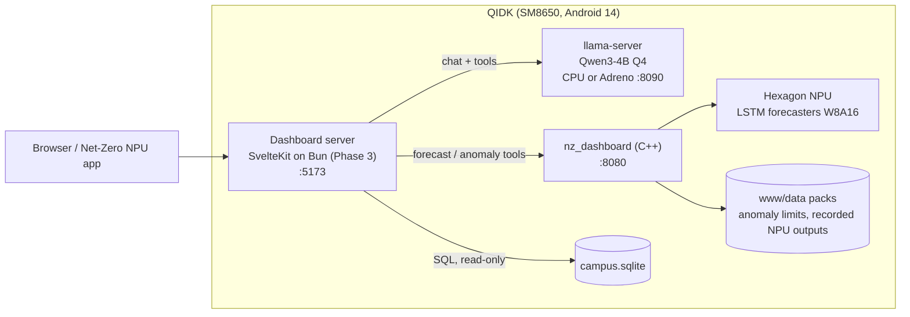

# Integration plan: the campus assistant (SLM) on the QIDK, wired to the forecasters

*Written 2026-11-16. Status: plan only. Nothing in this document has been built yet. Everything under "Facts" was checked on this date.*

> **See also [../plan.md](../plan.md)** (2026-11-16): how this fits with the scheduler, grouped models and the mentors' API. Its §2.4 changes which tools Phase 2 should build.

---

## TL;DR

* `qidk_export/` holds a **second, separate system**: a SvelteKit dashboard over `campus.sqlite` (365 nodes, all of 2025) with an assistant. The assistant is **Qwen3-4B-Instruct (Q4_K_M, 2.4 GB)** served by llama.cpp, and it answers only by calling 7 database tools. It currently runs on the laptop's Intel Arc GPU.
* The project's main line, the **LSTM forecasters on the Hexagon NPU** with the anomaly layer and the `nz_dashboard` C++ server, knows nothing about it, and the assistant knows nothing about the forecasts.
* **"Incorporating the SLM" means two things:**
  1. **Move it onto the board.** llama-server runs on the QIDK, so the assistant runs on the device too, not in the cloud and not on the laptop.
  2. **Give it the models as tools.** Add `forecast`, `check_anomalies` and `model_info`, which call the NPU forecasters that already run on the board (`nz_dashboard` `/api/demo`, plus the recorded outputs and anomaly limits in `dashboard/www/data/`). The assistant can then answer "what will solar be at noon tomorrow, and was yesterday's dip a fault?" from the NPU's output.
* **Order:** model server on the board first (biggest risk, least code). Then the forecast tools. Then moving the dashboard server onto the board. Then tuning. Then evaluation. Each phase leaves something that can be demoed.
* **The weakest link is not the model, it's Bun.** Bun has no Android build, so running the dashboard server itself on the board needs a workaround (Phase 3). Until that's solved, the dashboard runs on the laptop and calls the board for both the SLM and the NPU. That is already a working edge demo.

---

## 1. Facts this plan rests on

### 1.1 What `qidk_export/` contains

| Path | What | Size |
|---|---|---|
| `dashboard/` | SvelteKit 3 + Svelte 5 app, run with Bun (`bun --bun vite dev`). Map, net-zero what-if, assistant panel | 252 KB |
| `dashboard/src/routes/api/chat/+server.ts` | Agent loop: system prompt → OpenAI-style `/chat/completions` with `tools` → runs tool calls → up to 6 rounds. Streams NDJSON to the browser | 154 lines |
| `dashboard/src/lib/server/tools.ts` | The 7 tools: `data_overview`, `search_nodes`, `get_node`, `get_stats`, `compare_nodes`, `net_zero`, `show_node` | 271 lines |
| `dashboard/src/lib/server/db.ts` | All SQL, through **`bun:sqlite`** (read-only) | 176 lines |
| `dashboard/scripts/slm.sh` | Starts `llama-server` on port 8090, `--jinja --ctx-size 8192 --parallel 1`, plus a tool-calling chat template | – |
| `data/campus.sqlite` | Everything the dashboard shows | 4.3 GB |
| `models/Qwen3-4B-Instruct-2507-Q4_K_M.gguf` | The SLM | 2.4 GB |
| `README.txt` | Board install notes: needs an aarch64 `llama-server` and `bun` | – |

The dashboard reaches the model only through `SLM_URL` (OpenAI chat API with tool calling). **Any server that speaks that API can take the model's place without code changes**, and Phase 1 relies on this.

### 1.2 The board (QIDK `d42f06b`, queried over adb on 2026-11-16)

| | |
|---|---|
| SoC | SM8650 (Snapdragon 8 Gen 3), Android 14 |
| CPU | 8 cores. Features include `asimddp` (dot product), **`i8mm`**, `bf16`, so llama.cpp's fast ARM int8 kernels apply |
| GPU | Adreno 750. `libOpenCL.so` is present in `/vendor/lib64`, so llama.cpp's OpenCL (Adreno) backend is an option |
| NPU | Hexagon HTP v75, already used by the forecasters through QAIRT 2.47 |
| RAM | 11.6 GB total, **9.4 GB available** |
| Storage | `/data`: **168 GB free** |
| Already on the board | `/data/local/tmp/nz_aimet` (QNN runtime, `nz_dashboard`), `/data/local/tmp/nz_bench` (benchmark models + `demo.sh`), `qairt-2.37.1`, `campus_energy`, `my_models` |

**Memory budget:** model 2.4 GB + KV cache at 8,192 context (Qwen3-4B: 36 layers × 8 KV heads × 128 dim × 2 × fp16 ≈ 144 KB per token → ≈ 1.2 GB) + compute buffers ≈ **4 GB**. `campus.sqlite` is read through the page cache, not loaded. This fits in 9.4 GB alongside `nz_dashboard`.

### 1.3 What the forecasters already expose on the board

* `nz_dashboard` (C++, port 8080) has `GET /api/demo?cmd=forecast&model=<m>&window=<w>&prec=
`. It runs `benchmark_qidk/board/demo.sh` and returns JSON: `start` (IST), `H` (4 or 96 steps), `actual`, `npu`, `qnn_cpu`, `ort` (Solar, Grid, Demand interleaved, in W), and timings (`npu`, `npu_compute`, `ort` ms). Models: `guided_h4`, `baseline_h4`, `guided_24h`, `baseline_24h`, `cnn_lstm_24h`.
* Window ↔ time: `demo.sh` uses `start = TEST_START + (window + 96) × 900 s`. Inverting it gives `window = (t − TEST_START) / 900 − 96`. The test split is **10 Nov – 31 Dec 2025**, so forecasts only exist for that period.
* `nz_dashboard` also serves `dashboard/www/data/<model>/` as static files: `meta.json` (with the **per-hour anomaly median and limit**, `typical_W`, capacities, `timeline_start_utc`), `y.f32` (actuals), `npu.f32` (recorded NPU outputs). That is everything the anomaly layer needs, with no new inference.

### 1.4 How the two data sources overlap

`campus.sqlite` has measured data for 10 of the forecasters' 11 nodes across 2025, including `EM-CR-SB00-00`, `SL-PL00-00` and the three `SR-EM-KH04-*` meters. `SL-VN95-00` has no measured rows under that ID. So the assistant can put a forecast next to the database's own history for the same meters. The forecasters' **inputs** still come from the prepared test windows on the board, not from the database. Building windows from `campus.sqlite` would mean re-implementing the 58-feature pipeline, and that is out of scope (§7).

---

## 2. Target architecture

Until Phase 3 is done, the box labelled *Dashboard server* runs on the laptop and reaches `:8090` and `:8080` through `adb forward`. Nothing else in the diagram changes.

**Design rules, carried over from both systems:**
* The SLM never touches a file or a model directly. It only calls tools, and every tool call is shown in the chat (as now).
* Tool results stay small (a handful of numbers), because a 4B model loses track of long lists.
* Anything the forecasters are bad at is said by the **tool**, not left to the model. Demand is marked unreliable (negative R² for every model), 24 h grid is marked as no better than the mean, and times outside the test period return an explicit "no forecast exists for this time".
* One NPU job at a time (`nz_dashboard` already has a mutex).

---

## 3. Phases

### Phase 1: run the SLM on the board (the dashboard stays on the laptop)

**Goal:** the existing assistant works unchanged, with its model running on the QIDK.

| # | Task | Detail |
|---|---|---|
| 1.1 | Cross-compile `llama-server` for Android | Same NDK as `nz_dashboard` (r26c, `aarch64-linux-android31`). `cmake -DCMAKE_TOOLCHAIN_FILE=$NDK/build/cmake/android.toolchain.cmake -DANDROID_ABI=arm64-v8a -DANDROID_PLATFORM=android-31 -DGGML_OPENMP=OFF -DLLAMA_CURL=OFF -DBUILD_SHARED_LIBS=OFF`, with `-march=armv8.6-a+dotprod+i8mm` (or `GGML_CPU_ARM_ARCH`). Use a **recent** llama.cpp, so Qwen3's own chat template parses and `qwen-tools.jinja` becomes optional. Save the build script as `qidk_export/board/build_llama.sh` |
| 1.2 | Push to the board | `/data/local/tmp/nz_slm/{bin/llama-server, models/*.gguf, qwen-tools.jinja}`. Use `adb push --sync`, the same pattern as `14_dashboard_start.sh` |
| 1.3 | Board launcher | `qidk_export/board/slm_start.sh`: `pkill llama-server` (name match, not `pkill -f`, which matched its own shell before; see doc 17), start detached with `setsid nohup … &` so `adb shell` returns (or a tiny wrapper with the `--daemon` double fork from `nz_dashboard`), `--host 0.0.0.0 --port 8090 -t 6 --ctx-size 8192 --parallel 1 --jinja`, then `adb forward tcp:8090 tcp:8090`. Add `--stop` |
| 1.4 | Point the dashboard at it | `SLM_URL=http://127.0.0.1:8090/v1 bun run dev` on the laptop. No code change |
| 1.5 | Measure | `llama-bench` on the board for prompt processing and generation tok/s at `-t 4/6/8`. Also time to first token on the first and second questions, RSS of `llama-server` (`/proc/<pid>/status`), and SoC temperature after 5 questions. Record everything in `qidk_export/SLM_ON_QIDK_LOG.md` |

**Done when:** the six example questions in `dashboard/HOW_IT_WORKS.md` Part 6 give the same tool calls and the same numbers as on the laptop, with the model on the board.

**What to expect (to be measured, not promised):** on the X4/A720 cores with `i8mm`, a 4B Q4 model should generate in the region of 8–15 tok/s, against about 25 on the Arc GPU. Prompt processing is the real cost. The system prompt plus 7–10 tool schemas is about 2k tokens, so **the first question may take tens of seconds**. llama-server's prompt cache makes later questions reuse it. Phase 4 deals with this.

---

### Phase 2: give the assistant the forecasters as tools (the actual integration)

**Goal:** the assistant can answer questions about *forecasts and faults*, with the numbers coming from the NPU.

New file `dashboard/src/lib/server/forecast.ts` and three new entries in `tools.ts`. They talk to `nz_dashboard` through a new env var `NPU_URL` (default `http://127.0.0.1:8080`).

| Tool | Arguments | What it does | Returns (kept small) |
|---|---|---|---|
| `forecast` | `horizon`: `"1h"` \| `"24h"`; `at`: IST date-time (optional, default = latest available); `model`: `"guided"` (default) \| `"baseline"` | Maps `at` to a test window (§1.3), calls `/api/demo?cmd=forecast&model=guided_h4\|guided_24h&window=…&prec=w8a16` | Start time; per-step Solar and Grid forecast in kW (1 h: 4 values; 24 h: 24 hourly means plus the peak with its time and the total in kWh); the actual values (it's historical data, so they're known), MAE; NPU time in ms; a `caveat` for Demand and for 24 h Grid |
| `check_anomalies` | `from`, `to` (IST, within the test period); `signal`: `"solar"` \| `"grid"` | Reads `meta.json`, `y.f32`, `npu.f32` from `/data/all_sensors_1h/` (recorded NPU outputs) and applies the **same rule as `anomaly.py`**: flag when \|actual − forecast − median[hour]\| > limit[hour] | Count of flagged readings; the 5 largest, with time, actual, forecast and limit in kW; the false-flag rate on validation (Solar ≈2–3 %, Grid ≈1 %) as context |
| `model_info` | `model` (optional) | Static facts from `benchmark_qidk/results/summary.json` and the model `meta` files | What it forecasts, horizon, inputs, parameters, R² (FP32 and NPU), SQNR, NPU ms. For "how accurate / how fast / is this running on the NPU?" questions |

Supporting changes:

| # | Task | Detail |
|---|---|---|
| 2.1 | System prompt | Add routing lines: "forecast, predict, tomorrow, next hour → `forecast`"; "fault, anomaly, unusual, dropout, spike → `check_anomalies`"; "accuracy, NPU, how fast, which model → `model_info`". Add one rule: *"Forecasts exist only for 10 Nov – 31 Dec 2025. Say so if asked about other dates."* |
| 2.2 | Chat UI | `ChatPanel.svelte` already lists tool calls. Add labels ("↳ Ran the 1 h forecaster on the NPU (4.8 ms)", "↳ Checked 96 readings for faults") and a `ui` action that opens a small forecast-vs-actual chart (reuse `CompareChart.svelte`) |
| 2.3 | Lighter forecast call (optional) | `demo.sh forecast` runs NPU + QNN CPU + ONNX Runtime (≈3–5 s). Add a `cmd=npu` to `/api/demo` that runs the NPU only, for the assistant. That's a small change to `nz_dashboard.cpp` and `demo.sh` |
| 2.4 | Fault injection by chat (stretch) | "What if the Palash plant dropped out at 11:00?" → `check_anomalies` with an injected dropout, the same maths as the dashboard's in-browser injection. This connects the assistant to the existing demo story |
| 2.5 | Link to net zero (stretch) | `net_zero` already exists. A `forecast` result can feed "if tomorrow looks like this, how much grid power would X kW more solar save?". This is the first step of doc 18 §7 ("decisions, not metrics") |

**Done when:** a fixed set of forecast and anomaly questions (Phase 5) gets the right tool, the right window, and numbers that match `demo.sh` run by hand on the same window.

---

### Phase 3: run the dashboard server on the board too

**Goal:** the laptop only shows a browser (or nothing at all: the Android app). This matches how `nz_dashboard` works.

The obstacle: **Bun ships no Android build**, and `db.ts` uses `bun:sqlite`. Try these in order and stop at the first that works:

| Option | How | Effort | Risk |
|---|---|---|---|
| **A. Bun linux-aarch64-musl via its loader** | Push the musl `bun` plus `ld-musl-aarch64.so.1` and run `./ld-musl-aarch64.so.1 ./bun …` from `adb shell`. Production build: `bun --bun vite build` with `adapter-node` (already a dependency), then `bun build/index.js` | ½ day spike | Medium: Android's seccomp filter or missing `/tmp`/`/etc` paths can break it. Set `TMPDIR`, `HOME` |
| **B. Termux + Node** | Install Termux on the QIDK. Its `nodejs` package is a native Android build. Swap `bun:sqlite` for Node's built-in `node:sqlite` (`DatabaseSync`, `prepare().all/get`: about a 20-line change in `db.ts`) and run the `adapter-node` build | 1 day | Low technically, but it runs inside the Termux app, not from `adb shell`, so the launcher changes (`am startservice` / Termux `RUN_COMMAND` intent) |
| **C. Port the chat and tools into `nz_dashboard` (C++)** | Add `/api/chat` and the tools to the existing server with the SQLite amalgamation, and serve a static build of the dashboard (`adapter-static`) from it | 3–5 days (≈850 lines of TS logic, `whatif.ts` included) | Low, and the most consistent with the rest of the project (one native binary, no runtime), but the most work and two copies of the logic |

**Recommendation:** spike A. If it fails within half a day, use B for the eval and keep C as a post-eval clean-up only if the team wants a single binary.

Also in this phase:
* Push `campus.sqlite` (4.3 GB) to `/data/local/tmp/nz_slm/data/` once (168 GB free). Set `CAMPUS_DB` explicitly: `db.ts` defaults to `../../Resources/data/…` and the README says `../../data/…`, and neither exists on the board.
* The map background comes from OpenStreetMap tiles. If the board has no internet, the map is blank. Either accept that (the Net zero page and the assistant still work), or pre-render the campus tiles into `static/` (zoom 15–18 is a few MB).
* One launcher, `qidk_export/board/start_all.sh`: `nz_dashboard` → `llama-server` → dashboard server → `adb forward` for 5173/8080/8090 → print URLs. This extends `benchmark_qidk/scripts/demo_setup.sh` rather than adding a third start script.

**Done when:** after `start_all.sh`, unplugging USB and opening the dashboard from a phone on the same Wi-Fi gives a working map, Net zero page and assistant, including a forecast question.

---

### Phase 4: make it fast enough to demo

Only after Phase 1 numbers exist. Pick by measured gain:

| Lever | Expected effect | Note |
|---|---|---|
| Re-quantize to **Q4_0** (`llama-quantize --allow-requantize`, or better, from the F16 source) | Large gain in prompt processing on ARM: llama.cpp repacks Q4_0 into `i8mm`-friendly layouts at load. Q4_K_M doesn't get this path | Check that tool-calling accuracy holds (Phase 5) |
| **Adreno OpenCL backend** (`-DGGML_OPENCL=ON`, `-ngl 99`) | Offloads to the GPU and frees the CPU. Qualcomm optimised it for Q4_0 on Adreno 7xx | Build needs OpenCL headers/ICD. Compare against CPU on the same questions |
| Keep the prompt cached | First question pays for ~2k tokens, later ones reuse them. Use `--cache-reuse 256`; warm the cache at start by sending one dummy request from the launcher | Cheapest win: move the cost to boot time |
| Shorter system prompt and tool schemas | Fewer prefill tokens on every cold start | Measure the token count with `/tokenize` before and after |
| **Qwen3-1.7B** as a fallback | ≈2.5× faster | Likely worse at choosing tools. Only use it if Phase 5 says it's acceptable |
| `-t` and core affinity | Pin to the big cores (`taskset`), avoid the efficiency cores | Measure 4 / 6 / 8 threads |
| Hexagon NPU for the SLM (Genie, QAIRT) | The "proper" NPU path. Qualcomm publishes pre-compiled LLMs for SM8650 | **Out of scope for now:** needs a model from Qualcomm's catalogue (not this GGUF), has no OpenAI tool-calling server, and the forecasters already show the NPU. Mention it as future work |

**Target:** first answer under ~20 s after warm-up and typical answers under ~15 s. That's close to the laptop's 10–20 s.

---

### Phase 5: evaluate it (doc 18 §7.4: "only as an evaluated component")

The assistant only goes in the final deck with numbers behind it.

| # | Task | Detail |
|---|---|---|
| 5.1 | Question set | `qidk_export/eval/questions.jsonl`: ~30 questions. The 6 from `HOW_IT_WORKS.md`, ~10 database questions, ~10 forecast/anomaly questions, 4 that should be refused or caveated (a date outside the test period, Demand forecasts, "is the campus net zero in 2030?", made-up node IDs). Each one has the expected tool(s) and the expected key number from running the tool by hand |
| 5.2 | Runner | `qidk_export/eval/run_eval.ts` (Bun, on the laptop): posts to `/api/chat`, records tool calls, final text, time to first token, total time. Score: **right tool**, **right arguments**, **numbers in the answer match the tool result** (regex for numbers ±1 %), **caveat passed on** |
| 5.3 | Configurations | Laptop Arc (today's baseline) · QIDK CPU Q4_K_M · QIDK CPU Q4_0 · QIDK OpenCL · (optional) 1.7B. Same questions, `temperature 0.2`, 3 runs each |
| 5.4 | Resource numbers | Peak RSS, tok/s, SoC temperature. Does an NPU forecast slow down while the SLM is generating? (Run `/api/demo?cmd=speed` during generation and compare with `benchmark_qidk/RESULTS.md`) |
| 5.5 | Write-up | `qidk_export/SLM_EVAL.md`: one table per configuration, plus the failure cases quoted verbatim. Same style as `benchmark_qidk/RESULTS.md` |

**Done when:** we can say, with numbers, how often the on-board assistant picks the right lookup and repeats it faithfully, how long it takes, and what it costs the board.

---

### Phase 6: put it in front of people

| # | Task | Detail |
|---|---|---|
| 6.1 | Android app | Add an **Assistant** tab to `aimet_quantization/dashboard/android/` (Net-Zero NPU). Simplest option: a WebView tab on the dashboard's chat page at `http://127.0.0.1:5173`, the same Java bridge pattern as `api/…`. The app then shows LSTMs on the NPU and the SLM, all on one board |
| 6.2 | `nz_dashboard` web UI | A link or small panel to the assistant from the existing five tabs, so the two systems feel like one |
| 6.3 | Demo script | Add a section to `benchmark_qidk/DEMO.md`. Ask "Is the campus net zero?" (database), then "What will solar look like over the next hour from 11:00 on 3 Dec?" (NPU forecast), then "Was there anything unusual that afternoon?" (anomaly layer). Show the tool lines each time |
| 6.4 | Docs | Replace `qidk_export/README.txt` with a `README.md` (board install for real: paths, launcher, env vars). Add a "2.5 Campus assistant" section and a timeline row to `PROJECT_HISTORY.md`. Add a row to the root `README.md` table. Correct the `CAMPUS_DB` default mismatch noted in Phase 3 |

---

## 4. Order and rough effort

| Phase | Effort | Depends on | Demo after it |
|---|---|---|---|
| 1 SLM on the board | ½–1 day | – | Laptop dashboard, model on the QIDK |
| 2 Forecast tools | 1–2 days | 1 (or the laptop model, since it can be built in parallel) | "Ask the forecaster" by chat |
| 3 Dashboard on the board | ½–1 day (A/B) · 3–5 days (C) | 1 | Everything on the board |
| 4 Speed | ½–1 day | 1 | Shorter waits |
| 5 Evaluation | 1 day | 2, 4 | Numbers for the deck |
| 6 App, demo, docs | 1 day | 2, 3 | Final eval demo |

Phases 1 and 2 can run in parallel: Phase 2 can be developed against the laptop model while Phase 1 is being built.

---

## 5. Risks

| Risk | Likelihood | Impact | Mitigation |
|---|---|---|---|
| Bun won't run on Android | High (no official build) | Dashboard stays on the laptop | Phase 3 options A → B → C. The laptop-hosted version is a valid fallback demo: SLM and NPU are both still on the board |
| Prompt processing on the CPU too slow | Medium | 30–60 s first answer | Q4_0 repack, OpenCL, cache warm-up at start, shorter prompt (Phase 4) |
| 4B model picks the wrong tool more often once there are 10 tools | Medium | Wrong answers | Clear routing lines in the prompt, distinct tool names, `tool_choice: required` on round 1 (already done), Phase 5 measures it |
| Model treats a forecast as fact, or a historical "forecast" as the future | Medium | Misleading answers | The tool returns both forecast and actual, labelled; the prompt says the data is historical; Phase 5 includes caveat checks |
| Thermal throttling during long generation | Medium | Slower NPU and SLM | Measure in Phase 5.4; `-t 4` instead of 8 if needed |
| CPU contention: QNN CPU / ORT runs inside `demo.sh forecast` while the SLM generates | Low | Slower tool call | Phase 2.3 NPU-only command |
| Memory pressure (low-memory killer) | Low (≈4 GB of 9.4 GB) | llama-server killed | Keep ctx at 8k; don't run the 4.3 GB DB through anything that loads it whole |
| Llama.cpp Android build or template issues | Medium | Phase 1 delays | Recent llama.cpp; keep `qwen-tools.jinja` as fallback; `--jinja` |
| Board reboot loses everything started from `adb shell` | Certain | Demo stops | One launcher (`start_all.sh`), as with `demo_setup.sh` today |

---

## 6. Files this plan will add or change

| Path | New / changed | Phase |
|---|---|---|
| `qidk_export/board/build_llama.sh`, `slm_start.sh`, `start_all.sh` | new | 1, 3 |
| `qidk_export/SLM_ON_QIDK_LOG.md` | new | 1, 4 |
| `qidk_export/dashboard/src/lib/server/forecast.ts` | new | 2 |
| `qidk_export/dashboard/src/lib/server/tools.ts` | changed (3 tools) | 2 |
| `qidk_export/dashboard/src/routes/api/chat/+server.ts` | changed (prompt) | 2 |
| `qidk_export/dashboard/src/lib/components/ChatPanel.svelte` | changed (labels, chart) | 2 |
| `qidk_export/dashboard/src/lib/server/db.ts` | changed only for option B (`node:sqlite`) | 3 |
| `aimet_quantization/dashboard/server/nz_dashboard.cpp`, `benchmark_qidk/board/demo.sh` | changed (NPU-only command), optional | 2.3 |
| `qidk_export/eval/questions.jsonl`, `run_eval.ts`, `qidk_export/SLM_EVAL.md` | new | 5 |
| `aimet_quantization/dashboard/android/` | changed (Assistant tab) | 6 |
| `qidk_export/README.md` (replaces `README.txt`), `PROJECT_HISTORY.md`, root `README.md`, `benchmark_qidk/DEMO.md` | changed | 6 |

`model2/` stays untouched, as before.

---

## 7. Out of scope (and why)

* **Building forecaster inputs from `campus.sqlite`.** It would need the 58-feature pipeline (unit fixes, imputation flags, scalers) re-implemented over a different data source, and the models would then see data unlike their training set. The forecast tools use the prepared test windows instead.
* **Live data.** Both systems are historical (2025). The assistant says so.
* **Fine-tuning the SLM.** Tools and prompts first. Fine-tuning only if Phase 5 shows a systematic failure that prompting can't fix.
* **SLM on the Hexagon NPU (Genie).** See Phase 4. It's future work and worth one slide.
* **RAG over the project documents.** Doc 18 lists a "RAG-SLM". The tools already ground the answers in data. RAG over the docs ("why W8A16?") would be a separate, later feature with its own evaluation.
