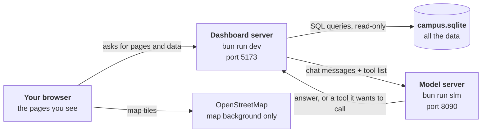

# How the dashboard works

This explains every part of the dashboard: what it is made of, what each part uses, and what happens
when you click something or ask the assistant a question. It assumes no prior knowledge of the code.

---

## Part 1. What it is

One web app with three things in it:

| Part | Where | What you do there |
|---|---|---|
| **Map** | `/` | see all 365 sensor nodes on the campus; click one to see its details, data and a chart |
| **Net zero** | `/whatif` | see the campus's 2025 carbon balance, and ask "what if we had more solar?" |
| **Assistant** | button at the top right, on every page | ask questions in plain English; a small language model looks the answer up |

Everything it shows comes from **one file**: `data/global_schema/campus.sqlite`. The app never changes
that file. It opens it read-only.

---

## Part 2. The four pieces

Four programs take part. Two of them you start yourself.



| Piece | What it is | Started by |
|---|---|---|
| **Browser** | shows the pages, draws the map and charts | you opening `http://localhost:5173` |
| **Dashboard server** | answers the browser: reads the database, runs the net-zero sums, talks to the model | `bun run dev` |
| **Database** | `campus.sqlite`, a single 4.5 GB file | nothing: it is just a file |
| **Model server** | runs the small language model and waits for chat requests | `bun run slm` |

Two rules follow from this picture:

- **The browser never touches the database.** It only asks the dashboard server.
- **The language model never touches the database either.** It can only ask the dashboard server to run
  one of seven fixed lookups (Part 6).

The only thing that leaves your machine is the request for map background images from OpenStreetMap.
No sensor data and no chat text is sent anywhere.

---

## Part 3. What each piece is built with

| Thing | What it is | Why it is used here |
|---|---|---|
| **Bun** | a program that runs JavaScript/TypeScript, and installs packages | you asked for it; it also has a SQLite reader built in |
| **SvelteKit** (v3, with Svelte 5) | the web framework: pages, plus small server programs behind them | one project holds both the pages and the data lookups |
| **`bun:sqlite`** | Bun's built-in SQLite reader | reads `campus.sqlite` with no extra install |
| **Leaflet** | a map library for the browser | draws the map and the markers |
| **OpenStreetMap tiles** | the map background pictures | free, and it shows the campus buildings |
| **Hand-written SVG charts** | the charts are drawn directly, with no chart library | small, and they show gaps in the data honestly |
| **llama.cpp** | a program that runs language models on an ordinary computer | it was already on this machine |
| **Qwen3 4B Instruct** (Q4, 2.5 GB) | the small language model | small enough for a laptop, and good at calling tools |

**SLM** means *small language model*: the same kind of thing as a chatbot's model, but small enough
(4 billion parameters, 2.5 GB) to run on a laptop instead of in a data centre. That is the point of your
project brief: intelligence on the device, not in the cloud.

The model runs on this laptop's Intel Arc graphics chip at about 25 tokens (roughly 18 words) a second,
so an answer takes 10 to 20 seconds.

---

## Part 4. What happens when you click a node

1. The page loads. The dashboard server sends the list of all 365 nodes: name, type, position, and how
   much real data each has.
2. The browser draws one marker per node. Nodes that share the exact same position become one `×N` marker.
3. You click `SR-EM-KH04-00`.
4. The browser asks the server: `GET /api/node/SR-EM-KH04-00`.
5. The server runs a few SQL queries and replies with the node's device, its data sources, the fields it
   sends, and its last message.
6. The panel appears. For the chart, the browser asks again:
   `GET /api/node/SR-EM-KH04-00/series?channel=…&source=…&from=…&to=…`.
7. The server averages the readings into at most about 360 points (per hour for a week, per day for a
   year) and sends them back. The browser draws the line.

How the marker looks tells you how much real data the node has:

| Marker | Meaning |
|---|---|
| filled | 1,000 or more real messages |
| outlined | fewer than 1,000 |
| dashed | none |

---

## Part 5. What happens on the Net zero page

**Net zero** means: over a year, the campus causes no more CO₂ than it removes.

### The sum

```
caused   = grid electricity bought (kWh) × 0.7 kg CO₂ per kWh
         + diesel generator output (kWh) × 0.8 kg CO₂ per kWh

removed  = CO₂ the campus trees absorb in a year

net      = caused − removed          net ≤ 0 means net zero
```

### Where each number comes from

| Number | Source |
|---|---|
| Grid electricity | the substation meter `EM-CR-SB00-00`, field `GDPower`, averaged every 15 minutes over 2025 |
| Diesel output | the generator meter `EM-CR-SB00-01`, fields `G1Power` and `G2Power` |
| Solar | three solar nodes with a clean full year: `SL-NI03-00`, `SL-NI03-01`, `SL-PL00-00` |
| 0.7 kg/kWh | India grid factor, from `papers/carbon_calculations/Calculations.docx` |
| 0.8 kg/kWh | a typical diesel generator value. **Not from your documents** |
| Trees | 2,000 trees (IIIT-H's own count) and the campus's climate; explained below |

### Result for 2025

| | t CO₂ |
|---|---|
| Caused | 2,375 |
| Removed by trees | −38 (range 23 to 61) |
| **Net** | **+2,337** (range +2,314 to +2,353) |

So on this data the campus is **not** net zero. Trees offset about 1.6% of what is caused.

### The tree estimate, specific to this campus

1. **How many trees: 2,000.** IIIT-H's own figure is "over 2,000 trees" on its 66-acre campus
   (institute blog, July 2025). The 1,200 saplings planted that month are too small to count yet.
2. **How big one tree is.** Chave et al. (2014) give a formula that uses the site's climate instead of
   a measured height:
   `biomass = exp(−1.803 − 0.976·E + 0.976·ln(density) + 2.673·ln(D) − 0.0299·ln(D)²)`.
   `E` is the climate stress at the site, read from their global map: **0.937 at the campus**
   (17.4455 N, 78.3489 E). Hyderabad is hot, dry and seasonal, so trees are shorter for the same trunk:
   about 8 m at a 26.4 cm trunk. That gives about 184 kg per tree.
3. **How much it grows.** In a year the trunk widens by 0.3 to 0.8 cm (0.5 central). Work out the
   biomass again with the wider trunk; the difference is one year's growth.
4. Add 26% for roots. 47% of biomass is carbon. Carbon × 3.67 = CO₂.
5. That is about 19 kg of CO₂ per tree per year (11 to 31). Times 2,000 trees = 38 t.
   The project brief quotes about 21.7 kg per tree, inside this range.

**The tree count decides this.** `Calculations.docx` uses 46,000 trees and gives no source for it; that
is one tree for every 6 m² of the whole campus, buildings included. With 46,000 trees at the same
per-tree rate, absorption would be 874 t and net emissions +1,502 t: still not net zero. That document's
own total, 6,191 t a year, also uses a formula that gives 3,091 kg per tree and divides the whole stock
by 50 years.

**Still assumed:** wood density 0.6 g/cm³ (no species list for the campus was found) and the growth
rate. The 26.4 cm trunk diameter is from the document.

### The "more solar" slider

Moving the slider adds solar that follows the measured daily pattern. Every 15 minutes:

```
grid power with extra solar = max(0, measured grid power − extra solar power)
```

Solar is not subtracted as its own line in the balance, because it already shows up as less electricity
bought. If the extra panels make more than the campus needs at that moment, the surplus is not counted.

All of this is in one file, `src/lib/server/whatif.ts`, with every factor listed at the top in `ASSUMPTIONS`.

### What is not counted

Water pumping, sewage treatment and waste (the database has no usable history for them), and 42 days of
2025 that the substation meter did not record. All of these would push net emissions up.

---

## Part 6. What happens when you ask the assistant

A language model on its own only produces likely-sounding text. Asked "is the campus net zero?", it would
make something up. So it is not allowed to answer from memory. It is given **tools**: lookups the
dashboard server will run for it.

### One question, step by step

You type: **"Is the campus net zero?"**

1. The browser sends your question to the dashboard server (`POST /api/chat`), along with which page you
   are on and which node is selected.
2. The dashboard server sends the model three things: a page of instructions, the list of tools, and
   your question.
3. The model does not answer. It replies: *"call `net_zero` with no arguments"*.
4. The dashboard server runs that tool itself: it works out the balance from `campus.sqlite` and gets a
   small result, about ten numbers.
5. The server sends that result back to the model.
6. Now the model writes the answer from those numbers: *"The campus is not net zero. It has a net carbon
   emission of 2,337 tons of CO₂ … About 12.2 times today's solar output would be needed."*
7. The browser shows the answer, and above it the line **"↳ Worked out the carbon balance"** so you can
   see what was looked up.

That took 14 seconds. The model may ask for several tools in a row; the server allows up to six rounds.

### The seven tools

| Tool | What it does | Example question |
|---|---|---|
| `data_overview` | counts nodes by type, lists which have real history, lists the data sources | "What data do we have?" |
| `search_nodes` | finds nodes by words in their name, type or building | "Which water nodes are there?" |
| `get_node` | everything about one node: what, where, how much data, last message | "What is this node?" |
| `get_stats` | average, minimum, maximum of one value over a period; optionally per hour, weekday or month | "Which month used the most electricity?" |
| `compare_nodes` | the same value across several nodes, ranked | "Which solar node produced the most?" |
| `net_zero` | the carbon balance, optionally with more solar | "What if we had five times more solar?" |
| `show_node` | opens a node on the map | "Show me the substation" |

They are defined in `src/lib/server/tools.ts`. Each returns a deliberately small answer, because a small
model loses track of long lists. Where it matters, the tool does the thinking: `compare_nodes` names the
highest node itself, instead of leaving the model to compare numbers.

### Questions
  | Question | Lookup Made | Answer |
|---|---|---|
| Is the campus net zero? | `net_zero` | Not net zero; +2,337 t CO₂. Needs approximately 12.2× today's solar capacity. |
| What if we had five times more solar? | `net_zero` with +500% | Still not net zero; net emissions of approximately 344 t. |
| Which solar node produced the most on average? | `compare_nodes` | SL-VN02-01, 27.6 kW. |
| When is this node busiest? (KH04-00 selected) | `get_stats` by hour | 15:00, with the unit warning passed on. |
| Which month used the most electricity? | `get_stats` by month | April 2025, 583 kW average. |
| Hi | None | A plain greeting. |

### What keeps it honest

- **It must look things up.** For anything that looks like a real question, the server forces the first
  reply to be a tool call.
- **Every lookup is shown.** The chat lists each tool it used. The lookup is the fact; the sentence is
  the model's summary of it.
- **It reads real data by default.** Synthetic data is only used if you ask for it.
- **Warnings are passed on.** If a value's unit is not trusted, the tool says so and the model repeats it.

### What it gets wrong

It is a small model and it does make mistakes. Seen during testing:

- It sometimes words a ranking loosely ("followed by March and May" when May was higher).
- "Five times more solar" was read as "+500%", which is six times today's.
- Before the tools were tightened, it claimed there were no water sensors and named the wrong top solar
  node. Both now answer correctly, but similar slips are possible on other questions.

Check anything important against the lookup line, or against the page itself.

---

## Part 7. How to run it

Two terminals, both in `code/dashboard`:

```sh
bun run dev      # the dashboard, at http://localhost:5173
bun run slm      # the language model, on port 8090
```

The map and the Net zero page work without the second one. Only the assistant needs it.

| Setting | Default | What it changes |
|---|---|---|
| `CAMPUS_DB` | `../../data/global_schema/campus.sqlite` | where the database is |
| `SLM_URL` | `http://127.0.0.1:8090/v1` | where the dashboard looks for the model |
| `LLAMA_SERVER` | the Intel-GPU llama.cpp build in `~/ollama/` | which llama.cpp program to run |
| `SLM_MODEL` | `~/ollama/models/Qwen3-4B-Instruct-2507-Q4_K_M.gguf` | which model file |
| `SLM_PORT` | `8090` | the model server's port |

The dashboard talks to the model in the standard "OpenAI chat" format. Any server that speaks it and
supports tool calling can take the model's place, including one running on the Qualcomm QIDK: point
`SLM_URL` at it and nothing else changes.

---

## Part 8. Where things are

| File | What is in it |
|---|---|
| `src/lib/server/db.ts` | every SQL query for the map: node list, coverage, node detail, chart data |
| `src/lib/server/whatif.ts` | the net-zero balance, the tree estimate, the extra-solar replay |
| `src/lib/server/tools.ts` | the seven tools the model can call |
| `src/routes/api/chat/+server.ts` | the chat loop: instructions to the model, tool calls, replies |
| `src/routes/api/node/[id]/` | data for one node, and its chart |
| `src/routes/api/whatif/` | data for the Net zero page |
| `src/routes/+page.svelte` | the map page |
| `src/routes/whatif/+page.svelte` | the Net zero page |
| `src/routes/+layout.svelte` | the top bar shared by both pages |
| `src/lib/components/CampusMap.svelte` | the map and its markers |
| `src/lib/components/NodePanel.svelte` | the panel for one node |
| `src/lib/components/LineChart.svelte`, `CompareChart.svelte` | the charts |
| `src/lib/components/ChatPanel.svelte` | the assistant panel |
| `scripts/slm.sh` | starts the model server |
| `scripts/qwen-tools.jinja` | tells the older llama.cpp build how to format tool calls for this model |

---

## Part 9. Known limits

1. **The data is historical.** Almost everything is from 2025. Nothing updates on its own.
2. **Only 13 nodes have a year of real data**, all electricity or solar. The rest have a few points or none.
3. **The model server crashed once in testing**, with a graphics-driver error in the llama.cpp build. It
   has not repeated since, but if the assistant says the model is not running, start `bun run slm` again.
4. **The first question after starting the model is slower**, because it has to read its instructions
   once. Later questions reuse that work.
5. **The tree estimate is the weakest number on the Net zero page.** It now uses the institute's own tree
   count and the campus's climate, but wood density, growth rate and trunk diameter are not measured here.
6. **The diesel factor is not from your documents.** It barely matters, because the generators hardly ran.
